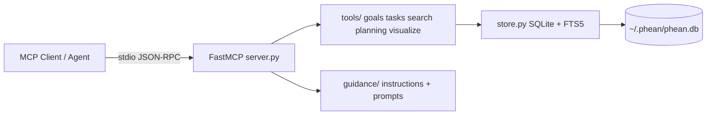
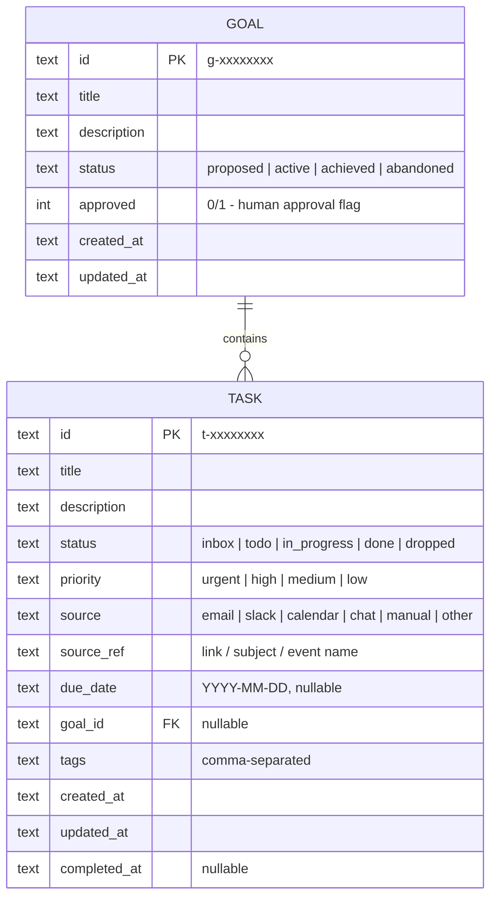

# Phean - Architecture

Phean is a single-process MCP server: Python 3.10+, [FastMCP](https://gofastmcp.com), one SQLite file, stdio transport. No ORM, no web framework, one runtime dependency.



## Code layout

```
src/phean/
├── server.py              # FastMCP app, wires store + tools + prompts, main()
├── models.py              # Enums (TaskStatus, GoalStatus, Priority, Source) + row helpers
├── store.py               # All persistence: schema, CRUD, FTS5 search, summaries
├── tools/
│   ├── goals.py           # create_goal, update_goal, list_goals
│   ├── tasks.py           # capture_tasks, update_task, complete_task, assign_tasks_to_goal
│   ├── search.py          # search
│   ├── planning.py        # plan_goal, suggest_next_actions
│   └── visualize.py       # visualize (Mermaid builders), get_status_summary
└── guidance/
    ├── instructions.md    # Server-level instructions (always in agent context)
    └── prompts.py         # triage_inbox, daily_review, scan_sources
```

Each `tools/*.py` module exposes `register(mcp, store)`; `server.py` calls them all. Mermaid builders in `visualize.py` are pure functions over plain dicts, so they are unit-testable without MCP.

## Data model

Two entities. Tasks optionally belong to one goal.



Lifecycles:

- **Task:** `inbox` (captured, untriaged) -> `todo` -> `in_progress` -> `done`; any state may go to `dropped`.
- **Goal:** `proposed` (agent-created, `approved=0`) -> `active` (human approved) -> `achieved` or `abandoned`.

IDs are `t-`/`g-` plus 8 hex chars - short enough to say aloud, unique enough for a personal database.

## Storage

`store.py` opens SQLite with `PRAGMA foreign_keys=ON`, row factory to dicts, and creates the schema idempotently on startup. Timestamps are UTC ISO-8601 strings.

Full-text search uses **FTS5 external-content tables** (`tasks_fts` over title/description/tags, `goals_fts` over title/description) kept in sync by insert/update/delete triggers. `Store.search()` sanitizes the user query by quoting each term (avoiding FTS5 syntax errors on characters like `-` or `"`), queries both FTS tables, and merges results tagged with `kind: task | goal`, ranked by FTS5's built-in `rank`.

The database path resolves as: explicit constructor arg > `PHEAN_DB` env var > `~/.phean/phean.db`. Tests use `:memory:`.

## MCP surface

### Tools (12)

| Tool | Signature (essentials) | Notes |
| --- | --- | --- |
| `create_goal` | `title, description?, status?` | Agent-created goals default to `proposed`/unapproved |
| `update_goal` | `goal_id, title?, description?, status?, approved?` | Setting `approved=true` is the human sign-off |
| `list_goals` | `status?` | Includes per-goal open/done task counts |
| `capture_tasks` | `tasks: [{title, description?, source?, source_ref?, due_date?, priority?, goal_id?, tags?}]` | Bulk intake; defaults to `inbox` status |
| `update_task` | `task_id, <any field>` | Also moves status (`todo`, `in_progress`, `dropped`, ...) |
| `complete_task` | `task_id, note?` | Sets `done` + `completed_at`; note appended to description |
| `assign_tasks_to_goal` | `task_ids: [..], goal_id` | Batch triage; moves `inbox` tasks to `todo` |
| `search` | `query, kind?, status?, goal_id?, limit?` | FTS5 + structured filters |
| `plan_goal` | `goal_id` | Goal + its tasks + a breakdown scaffold for the agent to fill |
| `suggest_next_actions` | `limit?` | Open tasks ranked by priority -> due date -> age |
| `visualize` | `kind: goal_tree \| kanban \| timeline, goal_id?` | Returns a Mermaid code block + text fallback |
| `get_status_summary` | - | Counts by status/goal, inbox size, overdue list |

### Prompts (3)

- `triage_inbox` - list inbox by proposed grouping, batch-request human approval, then apply.
- `daily_review` - summary, today's/overdue dues, top next actions, inbox-rot warning.
- `scan_sources` - checklist for sweeping the agent's own connectors and bulk-capturing findings.

### Server instructions

`guidance/instructions.md` is passed as FastMCP `instructions`, so every connected agent always has the operating rules in context: the four loops, the human-approval principle, and voice/tone rules. Tool descriptions repeat the critical rules locally (e.g., `update_goal` notes that approval is the human's call).

## Design decisions

1. **No connectors in Phean.** The agent's own integrations do source access; Phean stays connector-agnostic and never holds third-party credentials.
2. **Mermaid over UI.** Visualization is text returned through tools, rendered by the client chat. Each visualization also returns a plain-text summary in case the client cannot render a diagram type.
3. **Plain `sqlite3` over ORM.** The schema is two tables; an ORM would double the dependency surface for negative benefit.
4. **Scaffold, not planner.** `plan_goal` does not auto-generate plans; it returns structure (milestones, dependencies, first actions, open questions) that the *agent* fills in conversation. The intelligence lives in the agent; Phean provides shape and persistence.
5. **stdio only (MVP).** Local single-user product; HTTP transport is a post-MVP concern.
