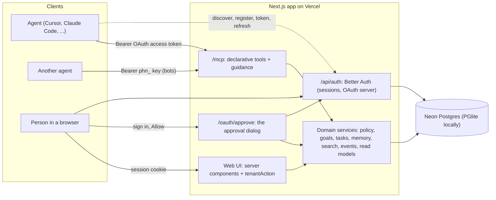
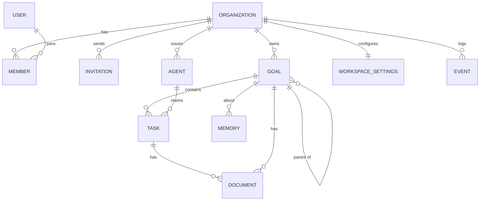
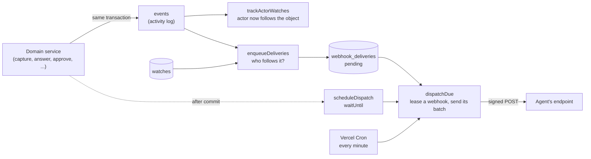

# Phean - Architecture

Phean is a single Next.js 16 app (TypeScript, App Router) hosted on Vercel, with Neon Postgres as its only store. Three adapters (the remote MCP endpoint, the web UI, and the auth endpoints) sit on **one domain layer**. Every rule about tenants, permissions, validation, and activity logging lives in that layer exactly once.



## Request flow

1. **Resolve a context.** The adapter turns its credential into `Ctx = { db, tenant, actor }`:
   - MCP: the bearer is either a fixed `phn_` key, hashed and looked up (`authenticateAgentToken`), or an OAuth access token, a JWT whose signature, issuer, audience (the endpoint it was sent to, `/mcp` or `/mcp/w/<slug>`), type and expiry are checked locally against the deployment's keys (`verifyOAuthToken`) and whose only claim Phean reads is `agent_id` (`resolveOAuthAgent`). Both end at one `agents` row, read through `liveAgent()`: not revoked, not past `access_expires_at`, an OAuth agent's approver still a member, and a sub-agent's parent all of those too. The row, never a claim or tool input, determines the tenant, the agent and its level, so no tool takes a workspace argument. A `Phean-Agent-Name` header then turns the principal into that agent's named sub-agent. At a workspace's own URL, `/mcp/w/<slug>`, a credential whose agent works in any other workspace is refused: the address must agree with the row, never choose it. Without a live credential the endpoint answers 401 with `WWW-Authenticate` naming `/.well-known/oauth-protected-resource` plus the endpoint's path, which is how a client finds the authorization server.
   - The agent's effective level is the lowest of its stored level, what its approver can grant now (an OAuth agent whose approver is demoted from admin drops to Write at once), and its parent's effective level. Each level gets its own MCP server, so `tools/list` shows only the tools that level may call.
   - Web: the session cookie gives the user, and the URL slug is resolved against that user's memberships. Non-members get the same 404 as a missing workspace.
2. **Validate.** Input is parsed with the service's zod schema. MCP tools and web forms use the same schema.
3. **Run the service.** It checks policy (`assertCan`), scopes every query by `tenant_id`, writes the change and its activity event in one transaction, and returns plain data.
4. **Format.** The MCP adapter returns JSON text plus `structuredContent`. Server actions return a form state and revalidate the workspace's pages.

Expected failures are `DomainError`s (`invalid`, `not_found`, `forbidden`, `conflict`). They become MCP `isError` results or inline form messages. Anything else is logged and surfaces only as `internal_error`.

## Code layout

```
src/
├── app/                         # Routes: adapters only, no business logic
│   ├── mcp/route.ts             # Remote MCP endpoint
│   ├── api/auth/[...all]        # Better Auth
│   ├── api/health               # Liveness + database round trip
│   ├── (auth)/                  # sign-in, sign-up, invite/[id] (shared centered layout)
│   ├── oauth/approve/           # The agent approval dialog: name, workspace, level, lifetime
│   ├── .well-known/             # OAuth protected resource and authorization server metadata
│   ├── workspaces/              # Status per customer + create workspace
│   ├── w/[slug]/                # Overview, board, timeline, goals/[id], memory, search, agents, members
│   │   ├── actions.ts           # Every workspace mutation, one line each via tenantAction
│   │   └── loading.tsx, error.tsx  # Tab-switch frame and in-workspace error boundary
│   ├── error.tsx                # App-wide error boundary (both render ErrorNotice)
│   └── globals.css              # The design tokens: Tailwind @theme, utilities, motion (see DESIGN.md)
├── components/                  # Domain components (TaskCard, GoalTree, KanbanBoard, ActivityFeed, ...)
│   ├── charts/                  # FlowBar, Timetable, CumulativeFlow, station colours
│   └── ui/                      # Design-system primitives (Button, Card, Badge, Field, Popover, ActionForm, ActionButton, CopyField, table cells)
├── lib/                         # Client-safe: domain vocabulary + labels, routes, formatting, timeline geometry, pure helpers
├── server/
│   ├── domain/                  # Services, policy, zod schemas, errors, context, read models
│   ├── mcp/                     # defineTool / serviceTool, the tool list, prompts and instructions, Mermaid views, handler
│   ├── auth/                    # Better Auth config, session and workspace resolution, membership operations
│   ├── db/                      # Drizzle schema (auth + domain), driver-agnostic client, FTS helpers, migrations
│   ├── actions.ts               # tenantAction / attempt: server-action plumbing
│   ├── forms.ts                 # formToInput: FormData to schema-shaped input
│   └── web.ts                   # Page helpers (orNotFound, absoluteUrl)
└── proxy.ts                     # Optimistic sign-in redirect (Next 16 "proxy")
drizzle/                         # Generated SQL migrations (committed)
scripts/                         # migrate, seed, demo-agents, mcp-agent (env.ts loads .env files the way Next does)
tests/                           # Vitest suites on in-memory PGlite
e2e/                             # Playwright UI tests against a production build
.github/workflows/ci.yml         # check and ui jobs on every pull request
```

## Interfaces

These contracts are what keep the adapters thin and the code DRY.

```ts
// Who is acting, and where. Built only from a verified token or session.
interface Ctx {
  db: Db;                                    // Drizzle, Postgres or PGlite
  tenant: { id: string; slug: string; name: string };
  actor:
    | { type: "user"; id: string; name: string; role: "owner" | "admin" | "member" | "platform_admin" }
    | { type: "agent"; id: string; name: string; role: "agent_read" | "agent_write" | "agent_admin" };
}

// Every domain service: it validates its own input (`.schema`), and returns plain data.
const updateGoal = service(UpdateGoalInput, async (ctx, input) => { ... });

// MCP: a tool that is one service is declared, never hand-wired. `key` names the result
// ({ goal }); annotations derive from readOnly/destructive. Tools that add links or format
// text (create_goal, visualize) use defineTool with `input: service.schema` instead.
serviceTool({ name: "update_goal", title, description, service: updateGoal, key: "goal" });

// Web: a server action is one line. It resolves the session from the posted slug, reads the
// fields the service's schema names, runs the service, revalidates the workspace, and returns form state.
export const updateGoalAction = tenantAction(updateGoal, { success: "Saved." });

// Tenant scope: every query on a tenant table filters through one of two helpers.
ctx.db.update(goals).set(patchOf(fields)).where(tenantRow(ctx, goals, goalId)); // also inTenant(ctx, goals)

// Authorization: one matrix, one function.
can(actor, "goal:decide"); // owner, admin, member: yes. agent, platform_admin: no.
```

`patchOf` builds an update from optional input fields: `undefined` leaves a column as it is and `null` clears it, so every update service treats "not given" the same way.

Other single sources of truth:

- **Domain vocabulary** (`lib/domain.ts`): statuses, priorities, sources, and memory kinds are `as const` arrays that drive the Postgres enums, the zod schemas, and the UI's `{ label, tone }` metadata tables. `STATIONS` is the board and chart order, and `isOneOf` narrows an untrusted value (a query parameter, a logged event field) to one of them.
- **Limits and patterns** (`lib/domain.ts`): `LIMITS` gives the zod schemas their maximums and the forms their `maxLength`. `WORKSPACE_SLUG_PATTERN` is both the schema's regex and the form's `pattern` attribute, and `slugify` suggests a slug from a workspace name.
- **Dates** (`lib/dates.ts`): calendar arithmetic in UTC days, matching how the database compares due dates. `isPastDue`, `isLate`, the timeline, the formatting helpers, the seeds, and the tests all use it.
- **Routes** (`lib/routes.ts`): every in-app path, used by pages, redirects, and the links MCP tools hand to agents.
- **Read models** (`domain/overview.ts`): `getWorkspaceStats` computes headline numbers for any number of workspaces in four grouped queries. It powers both the per-customer table and the `get_status_summary` tool.
- **Hierarchy helpers** (`lib/goal-tree.ts`): `toTree`, `withProgress`, and `subtreeIds` are pure functions shared by the MCP Mermaid views and the web pages.
- **Timeline model** (`lib/timeline.ts`): a task's history is a `Journey`, its stops at each station replayed by `buildJourneys` from the activity log (`task.captured`, `task.claimed`, `task.released`, `task.completed`, `task.updated`). `trackOf` turns a journey into the segments the timetable draws, `cumulativeFlow` counts each station at the end of every day, and `fitWindow` trims a window to the history a workspace actually has (at least `TIMELINE_MIN_DAYS`). `journeyTotals` gives the headline counts, `mostPressing` picks the tracks the overview shows, and `groupByGoal` sorts tracks under their goals. `getJourneys` (`domain/overview.ts`) loads them for a workspace or a goal subtree, capped so a 90-day window stays bounded. All of it is pure and unit tested; the chart components only lay it out.

## Storage

Neon Postgres in production via a `pg` pool on the pooled connection string, registered with `attachDatabasePool` so Vercel Fluid compute releases idle clients. Locally and in tests, PGlite (Postgres compiled to WebAssembly) runs the same schema and the same SQL, selected by `DATABASE_URL` (`postgres://...`, `pglite:./.data/pglite`, or `pglite:memory`).

The database handle used by Better Auth is opened lazily (`lazyDb`), so `next build` never connects.

### Data model



Auth tables (`user`, `session`, `account`, `verification`, `organization`, `member`, `invitation`, `rate_limit`) are generated from the Better Auth config. Organizations are Phean's tenants ("workspaces").

| Table | Highlights |
| --- | --- |
| `agents` | One row per agent identity, whatever its credential. `auth_kind` (`key` or `oauth`), `access_level` (`read`, `write`, `admin`; keys and existing agents are `write`), `access_expires_at` (null for keys), `created_by_user_id` (who issued or approved it), `oauth_client_id`. `token_hash` (SHA-256, unique) and `token_prefix` for a `phn_` key, both null for an OAuth agent. `last_seen_at` (written at most once a minute), `revoked_at`. One live OAuth agent per approver and name, so approving the same name again renews that row (its history and watches stay) |
| OAuth tables | `oauth_client`, `oauth_access_token`, `oauth_refresh_token`, `oauth_consent`, `oauth_resource`, `oauth_client_resource`, `oauth_client_assertion` and `jwks`, from `@better-auth/mcp`, `@better-auth/cimd` and the `jwt` plugin. Consents reference the agent id. Revoking an agent deletes its refresh tokens in `revokeTokensOf` |
| `goals` | Adjacency list (`parent_id`), max depth 4, cycle-checked with a recursive CTE. `status` enum; approval recorded in `approved_by_*` |
| `tasks` | Status, priority, source, `source_ref`, `due_date`, `tags text[]`, `claimed_by_agent_id`. Unique `(tenant_id, source, source_ref)` when `source_ref` is set, so agents scanning the same inbox never capture an item twice. `agent_sessions jsonb` (one `AgentSession` per agent, newest first, at most 8), `input_request jsonb` (the open question or decision, or null), `input_answers jsonb` (closed requests with their outcome and answer, newest first, at most 20) and `links jsonb` (references agents left, at most 10) hold the hand-offs to people. `parent_task_id` makes a task a subtask (composite FK within the tenant; one level deep, checked in `assertValidParent`) |
| `memories` | Long-term workspace memory: `kind` (fact, preference, decision, context, note), content, tags, optional goal or task link |
| `workspace_settings` | One row per workspace, made on first save: `workflow jsonb`, the board's stages (see Stages below) |
| `documents` | Files on tasks and goals: `format` (markdown, text, json, csv, yaml, mermaid, html, pdf, png, jpeg, gif, webp), `summary`, `size`, `sha256`, `version`, and `storage_key`, where the bytes live in the blob store. Title and summary are searchable |
| `document_blobs` | Document bytes (`bytea`) when no Vercel Blob store is configured |
| `agents` (sub-agents) | `parent_agent_id` (composite FK within the tenant, one level deep) and `purpose`. An agent mints tokens for its own sub-agents with `create_subagent` (at most 20 active), so each worker's work is attributed to it; revoking a parent revokes its sub-agents and disables their webhooks. A sub-agent can also share its parent's token and name itself with the `Phean-Agent-Name` header (or, on a fixed key, `?agent=` on the MCP URL; an OAuth resource URL with a query is a different resource and is refused): MCP auth (`resolveNamedSubagent`) finds or makes the parent's sub-agent of that name (`shares_parent_key`; its `token_hash` is a `shared:` placeholder no real token hashes to, which also keeps one row per name), and acts as it. A hub that relays for several bots can instead pass `actingAs` on any tool call, which `mcp/handler.ts` adds to every tool's input and resolves the same way per call, then checks the tool against that sub-agent's own level. A revoked name is refused; an agent at its limit keeps acting as itself. A request a sub-agent asks records its parent as `viaAgentName`, so people read "Grok research (via Grok Bot)" |
| `events` | Append-only activity log with actor, action, entity, summary, and JSONB `data`; indexed on `(tenant_id, created_at desc)` |

**Tenant isolation is structural.** Every domain table has `tenant_id` (cascade-deleted with the organization) and composite foreign keys such as `(tenant_id, goal_id) → goals(tenant_id, id)`. A task cannot point at another tenant's goal even if a service had a bug.

**Search.** Goals, tasks, and memories have generated `tsvector` columns (title weighted above description) with GIN indexes. User queries become prefix queries (`audit` matches `auditor`) after stripping operators, so no input can produce a syntax error.

**Agent sessions and questions** live on the task row rather than in tables of their own: a person reads them with the task, they are small and bounded, and they go when the task does. `lib/agent-sessions.ts` defines both shapes and the pure helpers around them (`withSession`, `movesSession`, `webUrl`), shared by the services, the seed, and the components. A session URL must use an allowed scheme (`RESUME_URL_SCHEMES`: `https`, `http`, and the app schemes of known agent and chat clients) and is stored normalized, so nothing an agent sends can become a `javascript:` link. Web links open in a new tab with `rel="noopener noreferrer"`; a task's `source_ref` is rendered as a link only when it is an `http(s)` URL. Read-modify-write on the JSON (linking a session, asking, answering) runs in a transaction on a row locked with `SELECT … FOR UPDATE`, so concurrent agents cannot drop each other's sessions.

**Questions and decisions.** An `InputRequest` has an id, a `kind` (`question` or `decision`), the question, the agent's context, up to 8 `options`, and `links`. When it closes it moves to `input_answers` as an `InputAnswer` with an `outcome`: `answered` or `answered_elsewhere` (a person, in Phean), `resolved` (the asking agent), or `closed` (the task was completed, released or moved out of progress). Only a person's outcome is delivered: those entries start with `collected: false`, and `collectAnswers` finds them with a JSONB containment query (`input_answers @> [{"agentId": …, "collected": false}]`), marks them collected on locked rows and returns them, so each answer reaches the asking agent exactly once. Status changes that do not read the row first archive the open request in SQL (`archiveOpenRequest`), which works because every expression in an `UPDATE … SET` reads the row as it was.

**Waiting for an answer.** `waitForAnswers` polls `collectAnswers` every 1.5 s until it returns something or `timeoutSeconds` (at most 240) runs out. Polling the database, rather than signalling in process, means an answer given on any serverless instance wakes an agent waiting on another. A blocking tool call is the one way to wake an agent mid-turn that every MCP client supports; the `/mcp` route's `maxDuration` is 300 s to leave room for it. Some clients abandon a tool call after 60 s, so the default wait is 55 s and the guidance tells agents to wait again on `timedOut`.

**Stages.** A task's `status` is one of six kinds (`inbox`, `backlog`, `todo`, `in_progress`, `done`, `dropped`), which lateness, claims, the timeline replay, the charts and agents all understand. A workspace's board is a list of stages (`lib/workflow.ts`): each kind's built-in stage (key = the kind; it can be renamed or hidden, never removed) plus stages of its own inside a kind ("Review" in `in_progress`). A task in its kind's built-in stage has `stage = null`; in an added stage, `stage` holds that stage's key. `updateTask` with a `stage` sets the status to the stage's kind; a status change on its own clears the stage, and so do completing, claiming from another kind and releasing. Saving the workflow (`saveWorkflow`, owners and admins) validates it with `workflowProblem`, and tasks in a removed stage fall back to their kind's stage. A hidden stage leaves the move menus and stays on the board only while tasks are in it. **Operators and delegation.** A task has one operator at most (a database check): `claimed_by_agent_id` for an agent's claim, or `operator_user_id` for a person who took it (`takeTask`). `delegation` (`DELEGATION_STATES`: `handing_off`, `picking_up`, `returned`) is the handover around them, with `delegate_to_agent_id` or `delegate_to_user_id` (neither means anyone), `delegation_note` and `delegated_at`. `handOffTask` names the target (a live agent of the tenant, or a member) and leaves the operator in place; `claimTask` and `takeTask` pick a handoff up, transferring the operator and setting `picking_up`, which the new operator's next step (`settledBy`) clears; `releaseTask` sets `returned` with its note. Completing, dropping or moving a task out of progress clears both. Events are `task.handed_off`, `task.picked_up` and `task.handoff_cancelled`; a named agent hears `task.handed_off` with the reason `handed_to_you`, watch or not. Lanes run in `LANE_ORDER` (`lib/domain.ts`): Inbox, To do, In progress, Done, then Backlog, parked to the right of Done. Charts keep counting by kind in `STATIONS` order, coloured by station.

**Realtime events.** `/api/events` is a WebSocket for agents that can hold a connection but have no HTTPS endpoint for a webhook. The route authenticates before upgrading (`server/realtime/auth.ts`: a `phn_` key or an OAuth access token, through the same `authenticateAgentToken` or `verifyOAuthToken` then `resolveOAuthAgent` as `/mcp`; an access token's audience must be `/mcp` or the agent's own `/mcp/w/[slug]`, since the stream is part of the same protected resource, and the stream ends by the token's `exp` with `reconnect`, so the agent comes back with a refreshed one; as `Authorization: Bearer`, or the subprotocols `phean.v1` then `phean.bearer.<token>` for clients that cannot set headers, never a URL parameter, and `Phean-Agent-Name` for sub-agents), then `upgradeWebSocket` from `@vercel/functions` hands the socket to `runEventStream` (`server/realtime/stream.ts`), kept alive with `waitUntil`. The stream reads the workspace's events after a cursor every two seconds (index `events_tenant_id_idx`, at most five batches per read, at most the last 24 hours) and keeps those `reasonsFor` (shared with webhook routing) gives a reason, shaped as a webhook payload's events. Event ids commit out of order, so each read also looks back over the last minute for ids below the cursor it has not sent; delivery is therefore at least once, de-duplicated by `eventId`. Streams take a lease in `realtime_streams`, renewed with each 30-second access check (4401 when revoked, 1011 after two failed checks in a row), which caps them across instances per root agent (sub-agents count towards their parent) and per workspace (4429); it also pings every 25 seconds and drops a slow reader (1013), and before the invocation's deadline (`getDeadline`) sends `reconnect` with its cursor and closes with 4000, so the agent resumes with `after`. Only Vercel's runtime upgrades in a route handler; `next start` closes upgrade requests, so tests drive the stream on a plain `ws` server.

**Documents and the blob store.** `server/storage/blobs.ts` puts document bytes behind one interface with two drivers: private Vercel Blob storage (`access: "private"`) when `BLOB_READ_WRITE_TOKEN` is set, and the `document_blobs` table otherwise (local development, tests, a deployment without a store; `PHEAN_BLOB_DRIVER=database` forces it). With a store, reads fall through to `document_blobs` for documents saved before it was turned on, and deletes clear both, so adding a store later strands nothing. Keys are `tenants/<tenant id>/documents/<id>/v<version>`, and only services reach the store, after loading the document row through `tenantRow`, so a blob is never addressed by a URL a browser holds: the web app serves bytes from `/w/<slug>/documents/<id>/file`, which checks the session, sends text formats (HTML included) as plain text, and sets `nosniff` and a sandboxing CSP. Each edit writes a new key and deletes the previous version's after commit; `updateDocument` checks the version in the `UPDATE` itself, so of two concurrent edits one wins and the other gets a conflict, and `expectedVersion` lets an agent refuse to overwrite a person's newer edit. Agents change only documents they attached or a person wrote. Markdown renders in the browser with react-markdown (no raw HTML, unsafe link schemes dropped) and Mermaid in strict mode, loaded only when a diagram is on the page. Document events carry `taskId` and `goalId`, so watchers of the task or goal hear about them under the `tasks` and `goals` topics.

**Migrations** are generated by drizzle-kit into `drizzle/` and applied by `pnpm db:migrate`. On Vercel that runs inside `vercel-build`, before `next build`. Migrations are additive where they can be (`0002_agent_sessions` only adds columns with defaults), so the release still serving traffic keeps working against the migrated schema while the next one deploys, and rolling back needs no down-migration.

## Authentication and authorization

- **People**: Better Auth with email and password, plus GitHub and Google when configured. Sessions are cookies. Sign-in and sign-up go through Better Auth's HTTP endpoints, which are rate-limited with counters in Postgres.
- **Workspaces**: the Better Auth organization plugin. Roles are owner, admin, and member. Invitations are links: the invitation id is the unguessable capability, and accepting requires signing in with the invited email.
- **Agents, by OAuth** (the main path): Phean is an OAuth 2.1 authorization server for its own MCP endpoint, through `@better-auth/mcp`, `@better-auth/cimd` and the `jwt` plugin. A client knowing only the URL reads the protected resource metadata, then the authorization server metadata at `/api/auth`, identifies itself by a Client ID Metadata Document or open dynamic registration (public clients only, rate limited per address), and sends the person to `/oauth/approve` with PKCE (S256). The dialog, a signed request the provider hands over, asks for the agent's name, one workspace, a level (only those the person may grant) and a lifetime (1, 7, 30, 90 or 365 days, no "never"). On Allow, `approveAgent` creates or renews the agent and the provider issues a one-hour access token bound to the URL the client connected to (`/mcp`, or the workspace's `/mcp/w/<slug>`) carrying `agent_id`, plus a refresh token. A workspace's URL gets its `oauth_resource` row the first time a client asks for it; the dialog then offers only that workspace, and `customAccessTokenClaims` refuses a token for it to an agent of any other. Refresh re-checks the agent through `resolveOAuthAgent`, so a lapsed agent cannot refresh, and a replayed refresh token gets the same answer for 30 seconds (see `REFRESH_REUSE_SECONDS` in `auth/auth.ts`). Each approval reaches one workspace; another workspace is another connection, at that workspace's URL, because Cursor and VS Code keep one login per URL (see the spike notes' "Real clients").
- **Agents, by fixed key**: `phn_` keys with 256 bits of randomness, shown once, stored as hashes, revocable instantly, for bots that cannot open a browser. Only owners and admins issue them (`agent:issue_key`); they have Write access and no end date. An agent with `agent:delegate` issues keys for its own sub-agents.
- Either way, each agent is a named identity, so every change is attributed, and cutting it off (revoking, expiry, its approver leaving) takes effect on its next request because every request reads the row. Revoking an agent revokes its sub-agents, disables their webhooks and deletes their refresh tokens; an expired or orphaned agent's webhooks pause until it is renewed.
- **Platform admins**: emails in `PHEAN_PLATFORM_ADMINS` with a *verified* address see every workspace read-only. This is the operator's status-per-customer view.

The policy matrix (`lib/permissions.ts`, enforced by `domain/policy.ts`). An agent's role is its effective level: `agent_read`, `agent_write` or `agent_admin`.

| Action | owner / admin | member | Admin agent | Write agent | Read agent | platform_admin |
| --- | --- | --- | --- | --- | --- | --- |
| `workspace:read` | yes | yes | yes | yes | yes | yes |
| `goal:write`, `task:write`, `memory:write`, `document:write` | yes | yes | yes | yes | no | no |
| `goal:decide` (approve, achieve, abandon) | yes | yes | **no** | **no** | **no** | no |
| `agent:connect` (approve an agent, up to Write for members) | yes | yes | no | no | no | no |
| `agent:delegate` (sub-agents), `webhook:manage` (its own) | yes | no | yes | yes | no | no |
| `agent:manage` (revoke any agent) | yes | no | yes | no | no | no |
| `agent:issue_key`, `member:manage`, `workflow:manage` | yes | no | no | no | no | no |

A member can also revoke the agents they approved (`assertCanRevoke` in `domain/agents.ts`). Sub-agents get the lower of their parent's level and Write, so an Admin agent's workers cannot manage agents. An Admin agent cannot issue keys, because a key would outlive its expiry, or manage members, because an invitation would be a way around `goal:decide`.

"The agent proposes, the human disposes" is enforced here, not just in the prompts. Agent-created goals always start `proposed`, and only people can change a goal's status.

## MCP surface

Endpoint `POST /mcp` (Streamable HTTP, stateless, via `mcp-handler`), header `Authorization: Bearer <OAuth access token or phn_ key>`. Each access level has its own server, built on first use from the declarative tool list: a Read agent sees only `readOnly` tools, and the `adminOnly` tools (`list_agents`, `revoke_agent`, `list_members`) appear only for Admin agents. A tool call is checked against the level again when it runs.

| Area | Tools |
| --- | --- |
| Identity | `whoami` |
| Goals | `create_goal`, `update_goal`, `list_goals`, `get_goal` |
| Tasks | `capture_tasks` (bulk, deduplicated; `parentTaskId` for subtasks), `list_tasks`, `get_task` (one task with links, sessions, questions, parent, subtasks, activity), `update_task` (any field, `addLinks`/`removeLinks`, `parentTaskId`), `assign_tasks_to_goal`, `claim_task` (optionally with the agent's `session`; picks up a task handed to it), `hand_off_task`, `cancel_hand_off`, `release_task` (with a note), `complete_task` |
| Webhooks | `register_webhook` (one per agent; returns the signing secret once), `get_webhook` (status, delivery counts, recent deliveries), `ping_webhook`, `delete_webhook`, `watch`, `unwatch`, `list_watches` |
| Hand-offs to people | `link_session` (where a person resumes with the agent), `request_input` (a question, or a decision with options, context and links; returns `decisionsUrl`), `wait_for_answers` (block until a person answers), `collect_answers` (answers since last time, each once), `resolve_input` (close one's own question) |
| Memory | `remember`, `recall`, `forget` (agents can forget only what they saved) |
| Search and planning | `search`, `plan_goal`, `suggest_next_actions` (handoffs to the agent first; skips work other operators hold) |
| Views and coordination | `visualize` (Mermaid goal tree, kanban, gantt timeline), `get_status_summary`, `get_activity` |

Prompts: `sync_up`, `scan_sources`, `triage_inbox`, and `daily_review`. The server instructions cover the operating loop, multi-agent etiquette (sync first, claim before working, never duplicate), the approval rule, and voice. Every tool carries MCP annotations (`readOnlyHint`, `destructiveHint`, `openWorldHint: false`), and results that point at the web app include absolute URLs on the origin the agent connected to.

**Multi-agent coordination** relies on four database guarantees, not on agents behaving:

1. Capture deduplicates on `(source, source_ref)` and reports skipped items.
2. `claim_task` is an atomic conditional update. The loser gets a `conflict` naming the current claimant.
3. `get_activity` is a cursor over the shared event log (`since` is inclusive), so each agent can catch up on what the others did.
4. A task holds one open question at a time. Only the agent that asked (`resolve_input`) or a person (`answerInput`, from the web app) closes it, and `suggest_next_actions` skips tasks waiting on a person. A person's answer is delivered to the asking agent once, through `collect_answers` or `wait_for_answers`.

## Webhooks: telling bots what changed

Agents that run as services register an HTTPS endpoint (`register_webhook`, one per agent). Phean calls it, signed, as soon as something the agent cares about changes: a person's answer to its question, a decision on a goal it proposed, or a change to a task, goal or memory it follows.



### The event channel

1. **The activity log is the source.** Every change already writes an `events` row inside its own transaction, through `recordEvents`. Webhooks hang off that one function, so no service has to remember to notify anyone, and a new kind of change is covered as soon as it is logged.
2. **Relevance is a table, kept up to date automatically.** `watches` holds (agent, task | goal | memory). `recordEvents` adds a watch whenever an agent acts on an object: capturing, claiming, asking about, updating or completing a task; proposing or editing a goal; saving a memory. Forgetting a memory removes every watch on it. Agents add and remove watches with `watch` and `unwatch`, and see them with `list_watches`.
3. **Routing (`webhooks/routing.ts`) matches an event to watchers by what it concerns.** That is the object itself (`watching:task`), the goal it is filed under or the parent of a new sub-goal (`in_watched_goal`), and the task a memory is about (`about_watched_task`). Every answer to a question, and an answer taken back (`task.input_retracted`, the Undo a person has until the agent collects it), also goes to the agent that asked it (`asked_by_you`), watch or not. A webhook with `scope: "all"` gets everything else as `workspace`. Agents never get their own changes. Each event has topics (`decisions`, `tasks`, `goals`, `memory`), and a webhook gets only the topics it chose. "Decisions" are what a person decided for the agent: answers (and answers taken back), and goals approved, reactivated, achieved or abandoned.
4. **The outbox is transactional.** Routing writes one `webhook_deliveries` row per (webhook, event) in the same transaction as the change. A committed change always has its notifications; a rolled-back one never does. The reasons are stored on the row, so the payload says why each event was sent.
5. **"As soon as possible" is an after-commit kick, plus a sweep.**
   - `inTransaction` collects `onCommit` hooks and runs them after the outermost transaction commits.
   - When `recordEvents` queued deliveries, its hook calls `scheduleDispatch`, which runs the dispatcher under `waitUntil`, after the response is sent. A person's click reaches the bot's endpoint in well under a second (the UI test checks it arrives within seconds).
   - Kicks that land while the instance is already dispatching are folded into one more pass.
   - Vercel Cron calls `/api/webhooks/dispatch` every minute. It sends retries whose backoff has passed, picks up anything a kick missed (an instance that died, a deploy), and prunes deliveries older than 7 days.
6. **Dispatching (`webhooks/dispatch.ts`) leases a webhook, not a delivery.**
   - `UPDATE webhooks SET lease_until … WHERE id IN (SELECT … FOR UPDATE SKIP LOCKED)` lets any number of dispatchers run at once (kicks on several instances, the sweep) without two of them sending to the same webhook. Each webhook's events therefore go out one batch at a time, oldest first (up to 25 per request).
   - The lease lasts 60 seconds, so a dispatcher that dies mid-send only delays that webhook.
7. **Delivery is at-least-once, ordered per webhook.**
   - Only a 2xx counts; redirects are not followed. A timeout (10 s) or any other answer is a failure.
   - After a failure the webhook backs off (30 s, 2 m, 8 m, 32 m, about 2 h, then every 6 h) and retries the same batch, so later events never overtake earlier ones.
   - After 12 failures in a row (about two days) it is disabled and its pending deliveries are dropped as `dead`. A dead endpoint does not get weeks of history replayed at once.
   - The reason shows in `get_webhook` and on the Agents page; registering again re-enables it.
   - A batch can be delivered twice (for example, the endpoint answered after the timeout), so receivers de-duplicate by `eventId`.

### Payload and signing

```http
POST /phean HTTP/1.1
Content-Type: application/json
Phean-Signature: t=1762250000,v1=5c1b…
Phean-Webhook-Id: wh_…
Phean-Delivery-Id: dl_…

{ "type": "phean.events", "deliveryId": "dl_…", "webhookId": "wh_…",
  "workspace": { "slug": "acme", "name": "Acme" }, "agent": { "id": "ag_…", "name": "Scout" },
  "events": [ { "eventId": 812, "action": "task.input_answered", "entityType": "task", "entityId": "t_…",
                "summary": "Dana answered Scout on \"Pick the auditor\"", "actor": { "type": "user", … },
                "data": { "answer": "Okafor", … }, "reasons": ["asked_by_you", "watching:task"],
                "createdAt": "…", "url": "https://…/w/acme/decisions" } ] }
```

- **The payload is the event, not the object.** It carries what the activity log has (action, summary, actor, the event's data), the reasons, and a link into Phean. Bots read the current state with `get_task`, `get_goal` or `collect_answers`.
  - A delayed or retried delivery never carries stale state.
  - A payload never exposes more than the event did.
  - Answers still go through `collect_answers`, which marks each one delivered.
- **Signing:** `v1 = HMAC-SHA256(secret, "<t>.<raw body>")`. Receivers compare it in constant time and reject a `t` more than 5 minutes off, which stops replays.
  - The secret (`whsec_…`) is shown once, by `register_webhook`.
  - It is stored encrypted with AES-256-GCM, under a key from `PHEAN_WEBHOOK_KEY` or, failing that, derived from `BETTER_AUTH_SECRET` with HKDF.
  - `ping_webhook` sends a signed `phean.ping` to check an endpoint.
- **The endpoint's own credentials.** Many receivers (automation platforms, gateways) demand their own key on every call. `register_webhook` takes up to 10 `headers`, sent with every delivery and ping under Phean's own headers, which always win.
  - Their values are credentials, so they are stored encrypted like the secret (`headers_ciphertext`) and never returned. `header_names` keeps the names for `get_webhook` and the Agents page.
  - Names Phean sets or that change how a request is framed (`Content-Type`, `Host`, `Content-Length`, `Transfer-Encoding`, `User-Agent`, `Phean-*`…) are refused, as are values that are not one line, which prevents header injection.
  - Registering again keeps the headers unless `headers` is passed (`{}` removes them), so rotating the secret never silently drops the endpoint's key.
  - The headers authenticate Phean to the endpoint; the signature still lets the endpoint check the body is Phean's and unchanged.
  - [`skills/phean-webhooks/SKILL.md`](../skills/phean-webhooks/SKILL.md) gives bots Node and Python verifiers. `tests/skills.test.ts` runs both against `signPayload`, for valid, tampered, wrong-secret, replayed and malformed requests.

### Guarding the endpoint (SSRF)

Phean's servers call URLs that agents choose, so `webhooks/url-safety.ts` refuses anything that could reach a private network:
- URLs must use `https`, carry no credentials, and not name `localhost`, `.internal` or `.local` hosts.
- Every address the host resolves to must be public. Refused: loopback; RFC 1918; link-local (including `169.254.169.254`, the cloud metadata endpoint); CGNAT; unique-local and multicast; IPv4-mapped forms of all of these.
- The check runs at registration and again before every send, because DNS changes.
- Redirects are never followed.

The remaining gap is DNS rebinding between the check and the connection. Closing it needs pinning the resolved address in the HTTP client; that is left for when Phean takes untrusted agents. `PHEAN_WEBHOOK_ALLOW_PRIVATE=1` lifts the address checks for local development and the UI tests only.

### Why this design

- **A transactional outbox rather than a cursor over `events.id`.** Identity values are handed out when a row is inserted but become visible when the transaction commits, so ids can appear out of order. A dispatcher reading "everything after the last id I sent" would skip an event committed late, with no error. Rows written in the same transaction cannot be missed.
- **Watches rather than computing relevance at send time.** Who-follows-what is visible to agents and testable. It costs one indexed lookup per event, not a walk over claims, sessions, questions and goal trees for every delivery. It also stays correct after a task is released or reassigned: the agent that worked on it keeps hearing about it until it unwatches.
- **The outbox and a dispatcher rather than calling the webhook inside the request.** A slow or failing endpoint never slows a person's click, and retries survive the request that caused them.
- **Postgres rather than a queue service.** The outbox is already in the database that holds the change, so there is no second system to keep consistent. `SKIP LOCKED` gives the queue semantics needed at this scale. If volume grows, the dispatcher can move to Vercel Queues behind the same outbox.
- **One webhook per agent.** Its topics and scope cover the cases bots have asked for, and one place for the secret and the health status keeps it legible for people.

## Web UI

Server components read through the same services. Mutations are server actions created by `tenantAction` and rendered with `ActionForm` (`useActionState`), so forms work without client JavaScript and show errors inline. A one-click action (approve, revoke, forget, pick a decision's option) is an `ActionButton`, which posts fixed fields and reports only failures, because the page itself shows the result. Board drag and drop is the one place a client component calls an action directly: `DropLane` builds the same form fields the card's buttons post and calls `updateTaskAction` (or `completeTaskAction` for Done), and the action's revalidation redraws the board. The buttons stay as the keyboard way to move a card. Workspace pages refresh every 15 seconds while the tab is visible, so people watch agents work in near real time without websockets (agents can open one; see Realtime events). See [UX.md](UX.md) for the screens and [DESIGN.md](../DESIGN.md) for the visual system.

The diagrams are server-rendered HTML and CSS, not a charting library: tracks and bars are absolutely positioned spans placed by fractions of the time window, and the cumulative flow is one inline SVG. They ship no client JavaScript and stay accessible: each diagram has a text equivalent (per-row status notes, `aria-label` counts, or a numbers table). Hover effects are CSS only (`group-has-[li:hover]`), and motion respects `prefers-reduced-motion`.

Styling is Tailwind 4 with the default palette switched off (`--color-*: initial`), so only the tokens in `globals.css` exist. Status colour comes from the `{ label, tone }` tables in `lib/domain.ts` and the station colours in `components/charts/stations.ts`; components never pick a hue directly.

## Testing

Vitest, with a fresh in-memory PGlite database per suite and the real migrations applied. Database-backed tests call `seedWorkspace(db)` (`tests/support/db.ts`) in `beforeEach`: a new workspace with an owner, Dana, and two agents, Scout and Closer, connected through real tokens. Each test seeds what it asserts on, so the suites pass in any order (`pnpm exec vitest run --sequence.shuffle`).

- `domain`: goals (hierarchy, depth, cycles, roll-up progress, the status decision log), tasks (capture dedupe, manual add, claims, idempotent completion, clearing fields, no-op edits), agent sessions and questions (one session per agent, asking, answering, who may close a question, clearing on complete and release), memory and search, read models (status summary, multi-workspace stats, goal detail, board, timeline, journeys, workload).
- `policy`: the full role-by-action matrix, including agents being unable to decide goals.
- `isolation`: users and agents in one workspace cannot read, reference, or change another's data, through services, MCP, and the database's own foreign keys.
- `tenants`: members, pending invitations and share links, and reading Better Auth's role lists as one role.
- `agents`: token entropy and hashing, authentication, last-seen tracking, revocation, and sub-agents living and dying with their parent.
- `oauth`, `agent-approval`, `oauth-consent`: discovery documents, the 401 challenge, registration, PKCE, audience and expiry checks, revoked, expired, orphaned and demoted agents, renewal keeping the same agent, each level against each tool, and the dialog's choices.
- `mcp`: an MCP SDK client over Streamable HTTP against the real route handler, covering auth failures, tool list and annotations, prompts, errors, how tools name their results, the Mermaid views, two agents coordinating, and an agent asking a person and reading the answer.
- `config`: the environment readers (app URL precedence, trusted origins, platform admins, OAuth providers, database URLs).
- `views`, `lib`, `web`: Mermaid builders, dates, slugs, pure helpers, routes, MCP client snippets, form-to-schema parsing, and how server actions report failures.
- `timeline`: journeys replayed from events, track segments and ends, window fitting, cumulative flow, totals, grouping by goal, and which tracks the overview picks as most pressing.

Playwright drives Chromium against a production build (`next start` on port 3200) with a fresh on-disk PGlite seeded with the demo account. A setup project signs in once and the specs reuse its session, because sign-in is rate limited. Better Auth allows three sign-ups per 10 seconds from one client, so a spec that writes signs up at most one person (`newWorkspace` in `e2e/support/accounts.ts`), and a second person is the demo account in a browser context of its own. `e2e/support/agents.ts` issues a fixed key from the Agents page's **Key for a bot** panel and runs an agent over real MCP, `e2e/support/oauth-client.ts` is a scripted OAuth client that knows only the URL, and `openTab` (`e2e/support/navigation.ts`) moves between workspace tabs and waits for the new page.

- `journey`: the whole loop on a fresh account. A person signs up, creates a workspace, and issues a token; an agent connects over real MCP, proposes a goal, and captures and claims work; the person approves the goal and moves a task across the board; the overview, timeline, goal page, and workspaces table show the result.
- `resume`: an agent links a web session and a CLI session and asks two questions; the person sees them on the overview, the nav, and the board, follows the link, copies the session id and command, answers one in Phean and marks the other answered, and the agent reads the answer on the task.
- `manual-entry`: every place a person adds a task or goal by hand, and that each stays a quiet ghost button.
- `workspace-admin`: editing a goal and walking it through approve, abandon, and reactivate; remembering, filtering, and forgetting memory; search results and their links; revoking an agent and its token failing at once; inviting a colleague, cancelling an invitation, the demo account accepting its link, and removing it again. A member gets the keyless snippets but no fixed keys, and revokes the agent they approved but not the owner's; an owner issues a key from the quiet control, and the table shows each agent's connection, level and end date.
- `oauth`: a client connecting with only the URL, the approval dialog's choices, renewing by name, a member not offered Admin, tampered and expired requests, and clients on custom schemes.
- `diagrams`: the overview's order and its pressing tracks, the timetable's stations, ends, late notes, window switch and hover, the cumulative flow and its numbers table, window fitting, goal filtering, the goal page roll-up, board lanes and the folded Done lane, and the workspaces flow bars.
- `quality`: axe accessibility scans on every page and with the Resume and Answer panels open, nothing cut off at 375px, the phone card order, popovers inside the screen, and the Now chip clear of every date label at desktop and phone widths.
- `public`: the landing page's sample timetable, sign-in redirects, a refused password, and accessibility of the signed-out pages.

`pnpm check` runs typecheck, lint, and unit tests; `pnpm test:e2e` builds and runs the UI tests. GitHub Actions runs both on every pull request (`check` and `ui` jobs) and keeps the Playwright report and traces when the UI job fails. `next build` also runs on Vercel for every deployment.

## Design decisions

1. **One TypeScript app instead of Python MCP plus a separate UI.** Two stacks would duplicate validation, authorization, and data access.
2. **Postgres as the only store.** Hierarchy, search, JSONB events, and tenant-scoped integrity all fit one relational database. Neon adds serverless pooling, preview branches, and `pgvector` for later.
3. **Stateless MCP.** No session store or Redis. Every request authenticates and builds its context from the token.
4. **Policy in one function.** `can()` is the seam for moving to Permit.io fine-grained authorization later, without touching callers.
5. **Connectors stay in the agents.** Phean never holds email or Slack credentials. Agents bring their own integrations and Phean is the shared ledger.
6. **Polling for people, a stream for agents.** A 15-second refresh is good enough for people watching agents, and it keeps the web app serverless. Agents that need events within seconds and have no webhook endpoint open the `/api/events` WebSocket, which itself reads the event log rather than a broker.
7. **Webhooks from a transactional outbox.** Agents are told about changes by signed HTTPS calls queued in the same transaction as the change. They are sent right after commit, with a cron sweep for retries. See [Webhooks](#webhooks-telling-bots-what-changed).
