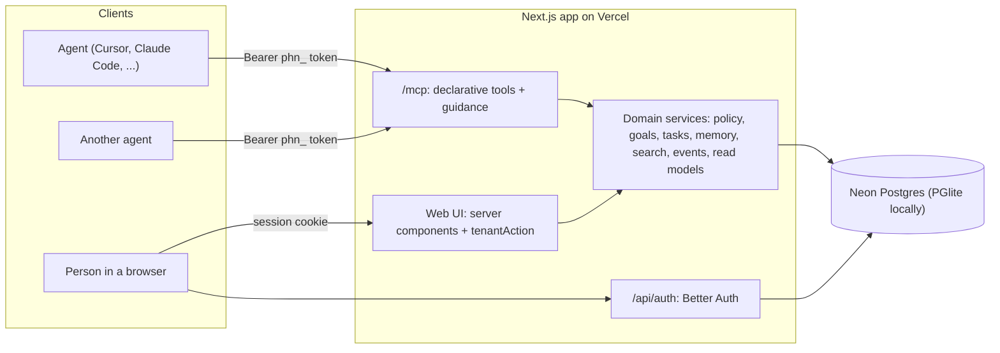
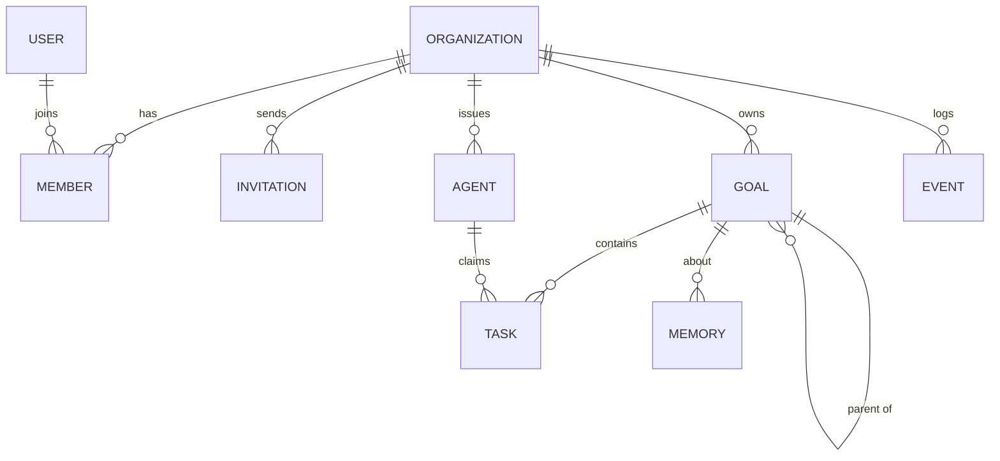

# Phean - Architecture

Phean is a single Next.js 16 app (TypeScript, App Router) hosted on Vercel, with Neon Postgres as its only store. Three adapters (the remote MCP endpoint, the web UI, and the auth endpoints) sit on **one domain layer**. Every rule about tenants, permissions, validation, and activity logging lives in that layer exactly once.



## Request flow

1. **Resolve a context.** The adapter turns its credential into `Ctx = { db, tenant, actor }`:
   - MCP: the bearer token is hashed and looked up. The token alone determines the tenant and the agent, so no tool takes a workspace argument.
   - Web: the session cookie gives the user, and the URL slug is resolved against that user's memberships. Non-members get the same 404 as a missing workspace.
2. **Validate.** Input is parsed with the service's zod schema. MCP tools and web forms use the same schema.
3. **Run the service.** It checks policy (`assertCan`), scopes every query by `tenant_id`, writes the change and its activity event in one transaction, and returns plain data.
4. **Format.** The MCP adapter returns JSON text plus `structuredContent`. Server actions return a form state and revalidate the workspace's pages.

Expected failures are `DomainError`s (`invalid`, `not_found`, `forbidden`, `conflict`). They become MCP `isError` results or inline form messages. Anything else is logged and surfaces only as `internal_error`.

## Code layout

```
src/
├── app/                         # Routes: adapters only, no business logic
│   ├── mcp/route.ts             # Remote MCP endpoint
│   ├── api/auth/[...all]        # Better Auth
│   ├── api/health               # Liveness + database round trip
│   ├── (auth)/                  # sign-in, sign-up, invite/[id] (shared centered layout)
│   ├── workspaces/              # Status per customer + create workspace
│   ├── w/[slug]/                # Overview, board, timeline, goals/[id], memory, search, agents, members
│   │   ├── actions.ts           # Every workspace mutation, one line each via tenantAction
│   │   └── loading.tsx, error.tsx  # Tab-switch frame and in-workspace error boundary
│   ├── error.tsx                # App-wide error boundary (both render ErrorNotice)
│   └── globals.css              # The design tokens: Tailwind @theme, utilities, motion (see DESIGN.md)
├── components/                  # Domain components (TaskCard, GoalTree, KanbanBoard, ActivityFeed, ...)
│   ├── charts/                  # FlowBar, Timetable, CumulativeFlow, station colours
│   └── ui/                      # Design-system primitives (Button, Card, Badge, Field, Popover, ActionForm, table cells)
├── lib/                         # Client-safe: domain vocabulary + labels, routes, formatting, timeline geometry, pure helpers
├── server/
│   ├── domain/                  # Services, policy, zod schemas, errors, context, read models
│   ├── mcp/                     # defineTool registry, tools, prompts and instructions, Mermaid views, handler
│   ├── auth/                    # Better Auth config, session and workspace resolution, membership operations
│   ├── db/                      # Drizzle schema (auth + domain), driver-agnostic client, FTS helpers, migrations
│   ├── actions.ts               # tenantAction / attempt: server-action plumbing
│   ├── forms.ts                 # formToInput: FormData to schema-shaped input
│   └── web.ts                   # Page helpers (orNotFound, absoluteUrl)
└── proxy.ts                     # Optimistic sign-in redirect (Next 16 "proxy")
drizzle/                         # Generated SQL migrations (committed)
scripts/                         # migrate, seed, demo-agents, mcp-agent (env.ts loads .env files the way Next does)
tests/                           # Vitest suites on in-memory PGlite
e2e/                             # Playwright UI tests against a production build
.github/workflows/ci.yml         # check and ui jobs on every pull request
```

## Interfaces

These contracts are what keep the adapters thin and the code DRY.

```ts
// Who is acting, and where. Built only from a verified token or session.
interface Ctx {
  db: Db;                                    // Drizzle, Postgres or PGlite
  tenant: { id: string; slug: string; name: string };
  actor:
    | { type: "user"; id: string; name: string; role: "owner" | "admin" | "member" | "platform_admin" }
    | { type: "agent"; id: string; name: string; role: "agent" };
}

// Every domain service: validated input in, plain data out. `.schema` is reused by adapters.
const createGoal = service(CreateGoalInput, async (ctx, input) => { ... });

// MCP: tools are declared, never hand-wired. Annotations derive from readOnly/destructive.
defineTool({ name: "create_goal", title, description, input: createGoal.schema, run: createGoal });

// Web: a server action is one line. It resolves the session, parses the form with the
// same schema, runs the service, revalidates the workspace, and returns form state.
export const createGoalAction = tenantAction(createGoal.schema, createGoal, { redirectTo });

// Authorization: one matrix, one function.
can(actor, "goal:decide"); // owner, admin, member: yes. agent, platform_admin: no.
```

Other single sources of truth:

- **Domain vocabulary** (`lib/domain.ts`): statuses, priorities, sources, and memory kinds are `as const` arrays that drive the Postgres enums, the zod schemas, and the UI's `{ label, tone }` metadata tables.
- **Routes** (`lib/routes.ts`): every in-app path, used by pages, redirects, and the links MCP tools hand to agents.
- **Read models** (`domain/overview.ts`): `getWorkspaceStats` computes headline numbers for any number of workspaces in four grouped queries. It powers both the per-customer table and the `get_status_summary` tool.
- **Hierarchy helpers** (`lib/goal-tree.ts`): `toTree`, `withProgress`, and `subtreeIds` are pure functions shared by the MCP Mermaid views and the web pages.
- **Timeline model** (`lib/timeline.ts`): a task's history is a `Journey`, its stops at each station replayed by `buildJourneys` from the activity log (`task.captured`, `task.claimed`, `task.released`, `task.completed`, `task.updated`). `trackOf` turns a journey into the segments the timetable draws, `cumulativeFlow` counts each station at the end of every day, and `fitWindow` trims a window to the history a workspace actually has (at least `TIMELINE_MIN_DAYS`). `getJourneys` (`domain/overview.ts`) loads them for a workspace or a goal subtree, capped so a 90-day window stays bounded. All of it is pure and unit tested; the chart components only lay it out.

## Storage

Neon Postgres in production via a `pg` pool on the pooled connection string, registered with `attachDatabasePool` so Vercel Fluid compute releases idle clients. Locally and in tests, PGlite (Postgres compiled to WebAssembly) runs the same schema and the same SQL, selected by `DATABASE_URL` (`postgres://...`, `pglite:./.data/pglite`, or `pglite:memory`).

The database handle used by Better Auth is opened lazily (`lazyDb`), so `next build` never connects.

### Data model



Auth tables (`user`, `session`, `account`, `verification`, `organization`, `member`, `invitation`, `rate_limit`) are generated from the Better Auth config. Organizations are Phean's tenants ("workspaces").

| Table | Highlights |
| --- | --- |
| `agents` | `token_hash` (SHA-256, unique), `token_prefix` for display, `last_seen_at` (written at most once a minute), `revoked_at` |
| `goals` | Adjacency list (`parent_id`), max depth 4, cycle-checked with a recursive CTE. `status` enum; approval recorded in `approved_by_*` |
| `tasks` | Status, priority, source, `source_ref`, `due_date`, `tags text[]`, `claimed_by_agent_id`. Unique `(tenant_id, source, source_ref)` when `source_ref` is set, so agents scanning the same inbox never capture an item twice |
| `memories` | Long-term workspace memory: `kind` (fact, preference, decision, context, note), content, tags, optional goal or task link |
| `events` | Append-only activity log with actor, action, entity, summary, and JSONB `data`; indexed on `(tenant_id, created_at desc)` |

**Tenant isolation is structural.** Every domain table has `tenant_id` (cascade-deleted with the organization) and composite foreign keys such as `(tenant_id, goal_id) → goals(tenant_id, id)`. A task cannot point at another tenant's goal even if a service had a bug.

**Search.** Goals, tasks, and memories have generated `tsvector` columns (title weighted above description) with GIN indexes. User queries become prefix queries (`audit` matches `auditor`) after stripping operators, so no input can produce a syntax error.

**Migrations** are generated by drizzle-kit into `drizzle/` and applied by `pnpm db:migrate`. On Vercel that runs inside `vercel-build`, before `next build`.

## Authentication and authorization

- **People**: Better Auth with email and password, plus GitHub and Google when configured. Sessions are cookies. Sign-in and sign-up go through Better Auth's HTTP endpoints, which are rate-limited with counters in Postgres.
- **Workspaces**: the Better Auth organization plugin. Roles are owner, admin, and member. Invitations are links: the invitation id is the unguessable capability, and accepting requires signing in with the invited email.
- **Agents**: `phn_` tokens with 256 bits of randomness, shown once, stored as hashes, revocable instantly. Each token is a named agent identity, so every change is attributed.
- **Platform admins**: emails in `PHEAN_PLATFORM_ADMINS` with a *verified* address see every workspace read-only. This is the operator's status-per-customer view.

The policy matrix (`domain/policy.ts`):

| Action | owner / admin | member | agent | platform_admin |
| --- | --- | --- | --- | --- |
| `workspace:read` | yes | yes | yes | yes |
| `goal:write`, `task:write`, `memory:write` | yes | yes | yes | no |
| `goal:decide` (approve, achieve, abandon) | yes | yes | **no** | no |
| `agent:manage`, `member:manage` | yes | no | no | no |

"The agent proposes, the human disposes" is enforced here, not just in the prompts. Agent-created goals always start `proposed`, and only people can change a goal's status.

## MCP surface

Endpoint `POST /mcp` (Streamable HTTP, stateless, via `mcp-handler`), header `Authorization: Bearer phn_...`. A fresh server is built per request from the declarative tool list.

| Area | Tools |
| --- | --- |
| Identity | `whoami` |
| Goals | `create_goal`, `update_goal`, `list_goals`, `get_goal` |
| Tasks | `capture_tasks` (bulk, deduplicated), `list_tasks`, `update_task`, `assign_tasks_to_goal`, `claim_task`, `release_task`, `complete_task` |
| Memory | `remember`, `recall`, `forget` (agents can forget only what they saved) |
| Search and planning | `search`, `plan_goal`, `suggest_next_actions` (skips other agents' claims) |
| Views and coordination | `visualize` (Mermaid goal tree, kanban, gantt timeline), `get_status_summary`, `get_activity` |

Prompts: `sync_up`, `scan_sources`, `triage_inbox`, and `daily_review`. The server instructions cover the operating loop, multi-agent etiquette (sync first, claim before working, never duplicate), the approval rule, and voice. Every tool carries MCP annotations (`readOnlyHint`, `destructiveHint`, `openWorldHint: false`), and results that point at the web app include absolute URLs on the origin the agent connected to.

**Multi-agent coordination** relies on three database guarantees, not on agents behaving:

1. Capture deduplicates on `(source, source_ref)` and reports skipped items.
2. `claim_task` is an atomic conditional update. The loser gets a `conflict` naming the current claimant.
3. `get_activity` is a cursor over the shared event log (`since` is inclusive), so each agent can catch up on what the others did.

## Web UI

Server components read through the same services. Mutations are server actions created by `tenantAction` and rendered with `ActionForm` (`useActionState`), so forms work without client JavaScript and show errors inline. Workspace pages refresh every 15 seconds while the tab is visible, so people watch agents work in near real time without websockets. See [UX.md](UX.md) for the screens and [DESIGN.md](../DESIGN.md) for the visual system.

The diagrams are server-rendered HTML and CSS, not a charting library: tracks and bars are absolutely positioned spans placed by fractions of the time window, and the cumulative flow is one inline SVG. They ship no client JavaScript and stay accessible: each diagram has a text equivalent (per-row status notes, `aria-label` counts, or a numbers table). Hover effects are CSS only (`group-has-[li:hover]`), and motion respects `prefers-reduced-motion`.

Styling is Tailwind 4 with the default palette switched off (`--color-*: initial`), so only the tokens in `globals.css` exist. Status colour comes from the `{ label, tone }` tables in `lib/domain.ts` and the station colours in `components/charts/stations.ts`; components never pick a hue directly.

## Testing

Vitest, with a fresh in-memory PGlite database per suite and the real migrations applied:

- `domain`: goals (hierarchy, depth, cycles, roll-up progress), tasks (capture dedupe, claims, completion), memory and search, read models.
- `policy`: the full role-by-action matrix, including agents being unable to decide goals.
- `isolation`: users and agents in one workspace cannot read, reference, or change another's data, through services, MCP, and the database's own foreign keys.
- `agents`: token entropy and hashing, authentication, last-seen tracking, revocation.
- `mcp`: an MCP SDK client over Streamable HTTP against the real route handler, covering auth failures, tool list and annotations, prompts, errors, and two agents coordinating.
- `views`, `lib`, `web`: Mermaid builders, pure helpers, routes, MCP client snippets, and form-to-schema parsing.
- `timeline`: journeys replayed from events, track segments and ends, window fitting, cumulative flow, and which tracks the overview picks as most pressing.

Playwright drives Chromium against a production build (`next start` on port 3200) with a fresh on-disk PGlite seeded with the demo account. A setup project signs in once and the specs reuse its session, because sign-in is rate limited.

- `journey`: the whole loop on a fresh account. A person signs up, creates a workspace, and issues a token; an agent connects over real MCP, proposes a goal, and captures and claims work; the person approves the goal and moves a task across the board; the overview, timeline, goal page, and workspaces table show the result.
- `diagrams`: the overview's order and its pressing tracks, the timetable's stations, ends, late notes, window switch and hover, the cumulative flow and its numbers table, window fitting, goal filtering, the goal page roll-up, board lanes and the folded Done lane, and the workspaces flow bars.
- `quality`: axe accessibility scans on every page, nothing cut off at 375px, the phone card order, popovers inside the screen, and the Now chip clear of every date label at desktop and phone widths.
- `public`: the landing page's sample timetable, sign-in redirects, a refused password, and accessibility of the signed-out pages.

`pnpm check` runs typecheck, lint, and unit tests; `pnpm test:e2e` builds and runs the UI tests. GitHub Actions runs both on every pull request (`check` and `ui` jobs) and keeps the Playwright report and traces when the UI job fails. `next build` also runs on Vercel for every deployment.

## Design decisions

1. **One TypeScript app instead of Python MCP plus a separate UI.** Two stacks would duplicate validation, authorization, and data access.
2. **Postgres as the only store.** Hierarchy, search, JSONB events, and tenant-scoped integrity all fit one relational database. Neon adds serverless pooling, preview branches, and `pgvector` for later.
3. **Stateless MCP.** No session store or Redis. Every request authenticates and builds its context from the token.
4. **Policy in one function.** `can()` is the seam for moving to Permit.io fine-grained authorization later, without touching callers.
5. **Connectors stay in the agents.** Phean never holds email or Slack credentials. Agents bring their own integrations and Phean is the shared ledger.
6. **Polling over websockets.** A 15-second refresh is good enough for watching agents, and it keeps the deployment serverless.
