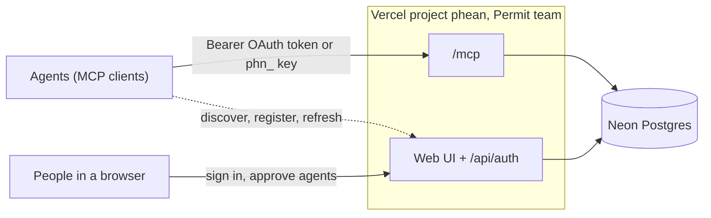

# Deploying Phean to Vercel

Phean is one Next.js app: the web UI, the auth endpoints, and the remote MCP endpoint all deploy together as Vercel Functions. All state lives in one Neon Postgres database.



## Current state of the Vercel project

| Setting | Value |
| --- | --- |
| Team | Permit (`team_5xJVYKrOpj2zXMJF6RzrtygY`) |
| Project | `phean` (`prj_moewgt7lQydZrSAyHVEgkTKCYFwt`), framework Next.js, Node.js 22.x |
| Git | `orweis/phean`, production branch `main`. Every push to `main` deploys production; other branches get previews |
| Production domain | `phean-alpha.vercel.app` |
| Database | Neon `phean-db` (free plan, `iad1` Washington, D.C.), connected to production and preview with a database branch per preview deployment |
| Deployment protection | Vercel Authentication on **preview deployments only**. Production stays public, because customers sign in with Phean's own login and agents call `/mcp` with their own tokens |
| Environment variables | `BETTER_AUTH_SECRET`, plus `DATABASE_URL` and the other `DATABASE_*` variables from Neon (production, preview) |

## First-time setup

Steps 1 and 2 are done for the Permit project; they are kept here for recreating it elsewhere.

### 1. Connect the repository

Vercel dashboard → Permit team → **phean** → Settings → Git → Connect Git Repository → `orweis/phean`, production branch `main`.

The Vercel GitHub app is installed on `orweis` with access to selected repositories only. If `phean` is not listed, add it under GitHub → Settings → Applications → Vercel → Repository access.

### 2. Add Neon Postgres

Project → Storage → Create Database → **Neon** (Vercel Marketplace), free plan. Leave Neon Auth off; Phean has its own login. Connect it to the `phean` project for Production and Preview, and tick **Create database branch for deployment → Preview** so previews never touch production data. Leave Development unticked so `vercel env pull` never hands out the production database.

Set the custom prefix to `DATABASE`. That yields `DATABASE_URL` (pooled), which is what Phean reads (falling back to `POSTGRES_URL`), plus `DATABASE_URL_UNPOOLED` and other `DATABASE_*` variables. Pick the Neon region closest to the project's function region (default `iad1`, Washington, D.C.).

Why Neon: goals form a hierarchy (recursive CTEs), memory and tasks need full-text search (`tsvector` with GIN indexes), every row is tenant-scoped with foreign keys, the activity log uses JSONB, and `pgvector` is available for semantic memory later. See [ARCHITECTURE.md](ARCHITECTURE.md#storage).

### 3. Environment variables

| Variable | Required | Purpose |
| --- | --- | --- |
| `DATABASE_URL` | yes | Set by the Neon integration |
| `BETTER_AUTH_SECRET` | yes | Signs sessions and the dialog's approval requests, and encrypts the OAuth signing key. Already set; see [Rotating `BETTER_AUTH_SECRET`](#rotating-better_auth_secret) before changing it |
| `BETTER_AUTH_URL` | no | Canonical public URL, and with it the OAuth issuer and the audience of MCP tokens. Defaults to the production domain on production and the deployment URL on previews. Must be HTTPS, or HTTP on loopback only: anything else makes Better Auth fail on first use, sign-in included. OAuth clients must connect at this exact address, so a branch alias needs it set |
| `PHEAN_OAUTH_REGISTER_LIMIT` | no | Raises how many OAuth clients one address may register a minute (default 5). The UI tests set it, since they all register from one address. Leave it unset on a real deployment |
| `PHEAN_PLATFORM_ADMINS` | no | Comma-separated emails with read-only access to every workspace (the operator's status-per-customer view). Only counts for **verified** emails, which in practice means accounts that signed in with GitHub or Google |
| `CRON_SECRET` | yes, for webhooks | Vercel sends it to the every-minute webhook sweep (`/api/webhooks/dispatch`, declared in `vercel.json`); production refuses the sweep without it. Generate with `openssl rand -base64 32` |
| `PHEAN_WEBHOOK_KEY` | no | Encrypts stored webhook signing secrets. Defaults to a key derived from `BETTER_AUTH_SECRET`; rotating either makes stored secrets unreadable, and agents re-register their webhooks |
| `GITHUB_CLIENT_ID`, `GITHUB_CLIENT_SECRET` | no | Enables "Continue with GitHub". Callback: `https://<domain>/api/auth/callback/github` |
| `GOOGLE_CLIENT_ID`, `GOOGLE_CLIENT_SECRET` | no | Enables "Continue with Google". Callback: `https://<domain>/api/auth/callback/google` |

### 4. Deploy

Push to `main`, or Deployments → Redeploy. Vercel runs the `vercel-build` script, which applies pending database migrations and then runs `next build`:

```bash
pnpm db:migrate && next build
```

Migrations are plain SQL files in `drizzle/`, applied in order and tracked in the database. A failed migration fails the build, so a broken schema change never goes live.

To ship a branch to production before it merges, create a production deployment from its Git ref rather than from a preview: `vercel deploy --prod` from a checkout of the branch, or the deployments API with `target: "production"` and a `gitSource` naming the branch and commit. That build runs with the production environment variables, so its migrations run against the production database, and it takes the production domain when it is ready. The next push to `main` replaces it.

### 5. Smoke test

```bash
curl https://<domain>/api/health
# {"status":"ok","database":"ok","latencyMs":12}
```

Then sign up, create a workspace, and connect a real client with only the URL (`claude mcp add --transport http phean-smoke https://<domain>/mcp/w/<workspace>`): it should open the approval dialog, and `whoami` should name the workspace afterwards. To run the two-agent demo, issue two fixed keys under **Key for a bot** on the Agents page:

```bash
pnpm demo:agents https://<domain> phn_first_token phn_second_token
```

It captures tasks (including a duplicate that must be skipped), proposes goals, races two claims on one task (one must be refused), completes work, and saves shared memory. The dashboard should show all of it, with the proposed goals waiting for your approval.

## Connecting agents

An agent connects with only the URL: its workspace's, `/mcp/w/<slug>`, or the shared `/mcp`. Its client gets a 401 naming the matching `/.well-known/oauth-protected-resource/...` document, finds the authorization server at `/api/auth`, registers itself (open dynamic registration for public clients, or a Client ID Metadata Document), and sends the person to `/oauth/approve` to sign in and choose the agent's name, workspace, level and lifetime. The workspace's **Agents** page has the snippets:

```bash
claude mcp add --transport http phean-acme https://<domain>/mcp/w/acme
```

The workspace's URL is its own OAuth resource, so a second workspace on the same client is a second sign-in rather than an overwrite (Cursor and VS Code key logins by URL). The agent's row still decides the workspace; the URL only has to agree, and a credential for another workspace gets a 401 there.

Access tokens last an hour and refresh on their own until the lifetime the person chose. A bot that can't open a browser gets a fixed `phn_` key instead, which an owner or admin issues under **Key for a bot** on the same page; it is shown once and sent as `Authorization: Bearer phn_...`.

Either credential resolves to one row of `agents`, which alone selects the workspace and the agent identity. Revoking, expiry, and the approver leaving the workspace take effect on the next request. So does a renewal: approving the same name again, from any client, refuses access tokens issued before it (`agents.tokens_not_before`, to the second) and deletes the old refresh tokens.

**Self-hosting needs HTTPS.** OAuth requires the issuer and the MCP resource to be HTTPS anywhere but loopback (`localhost`, `127.0.0.1`), and Better Auth fails on first use otherwise, sign-in included. Put the deployment behind TLS and set `BETTER_AUTH_URL` to its `https://` address; clients must connect at exactly that address.

## Rotating `BETTER_AUTH_SECRET`

Generate a new one with `openssl rand -base64 32`. Changing it:

- signs everyone out;
- invalidates approval requests already open in the dialog: the person starts again from their client;
- leaves the OAuth signing key in `jwks` unreadable, since it is encrypted with the secret. Delete those rows in the same change (`delete from jwks;`). Phean makes a new key on first use; access tokens signed with the old one stop verifying, and clients refresh to get new ones;
- makes stored webhook secrets unreadable unless `PHEAN_WEBHOOK_KEY` is set, so agents register their webhooks again.

## Preview deployments

Previews are behind Vercel Authentication. To call a preview's `/mcp` from an agent, create a Protection Bypass for Automation secret (Settings → Deployment Protection) and send it as the `x-vercel-protection-bypass` header alongside the bearer token.

## Operations

- **Logs and errors**: Vercel → phean → Logs. Unexpected tool failures are logged server-side and reach agents only as `internal_error`.
- **Rollback**: promote a previous deployment. Migrations only move forward, so write them to be backward compatible with the previous release (add columns before using them; drop them a release later).
- **Database branches**: Neon creates a branch per preview, so schema changes are exercised on a copy of production data before merge.
- **Webhooks**: deliveries go out right after the change commits. The cron in `vercel.json` (every minute; Hobby plans allow only daily crons, so this needs Pro) retries failures and prunes deliveries after 7 days. A webhook disabled after repeated failures shows its reason on the Agents page; the agent re-enables it by registering again.
- **Rate limiting**: sign-in, sign-up, OAuth client registration (5 a minute per address) and OAuth authorize (60 a minute per address) are rate-limited by Better Auth, with counters stored in Postgres so the limit holds across serverless instances. Authorize is limited because it fetches and stores a Client ID Metadata Document client before anyone signs in.
- **Unused OAuth clients**: anyone may register a client (`oauth_client`) without signing in. Clients over 24 hours old that no one consented to and that hold no token are deleted, up to 20 at a time, whenever a client registers or a metadata-document client authorizes; there is no job to schedule. A client deleted this way gets `invalid_client` on its next request, and registers again, or is fetched again from its metadata document, as MCP clients do.
