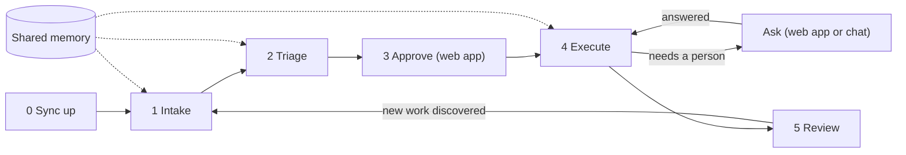
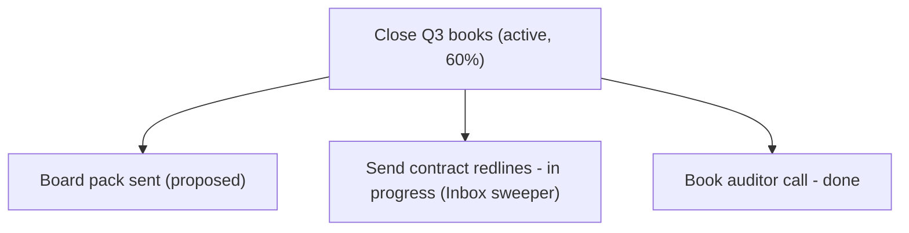
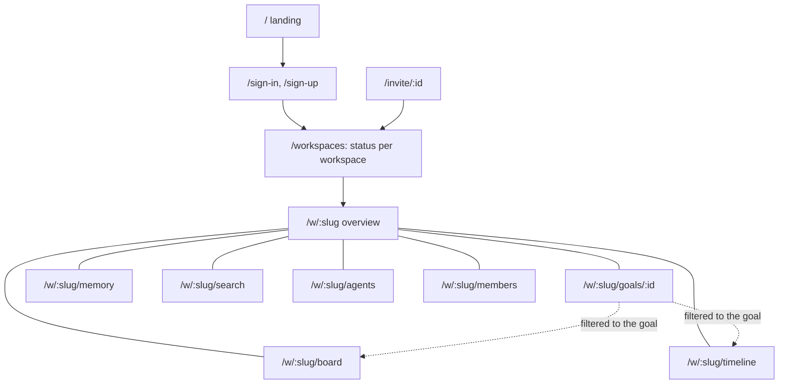

# Phean - UX Design

Phean has two surfaces, each built for one side of the work:

- **The conversation.** Agents connect over MCP, and people talk to their agents. The agent captures, triages, executes, and reports. Visual answers arrive as Mermaid diagrams in chat.
- **The web app.** People sign in to see status per workspace, approve or reject goals, step in on tasks, manage agents, and invite teammates. It refreshes itself while open, so agent work shows up without reloading.

The two meet in one shared ledger per workspace. Anything an agent does appears in the web app within seconds, and anything a person decides in the web app is what agents see next.

## Design principles

1. **Agents do the labor, people make the decisions.** Agents propose goals; only a person can approve, complete, or abandon one. This is enforced on the server, not just in the guidance, and the web app is where the decision happens.
2. **One ledger, many agents.** Several agents work in the same workspace. They coordinate through Phean (claims, duplicate detection, the activity log, shared memory) instead of through the human.
3. **Show, then tell.** Status answers lead with a picture (a diagram in chat, the timetable and flow bars in the web app), then a short read, then one suggested next step.
4. **Zero data entry for people.** People state intent ("track that audit thread"); agents structure it. The web forms exist for corrections and quick additions, not as the main way work gets in, so manual entry is always a quiet ghost button (see [Manual entry](#manual-entry)).
5. **Every hand-off is a link, both ways.** Agents return deep links (`reviewUrl` from `create_goal`, `dashboardUrl` from `whoami` and `get_status_summary`, `questionsUrl` from `request_input`) so a person can go straight from the chat to the decision. In the other direction, agents leave their session on the tasks they work on, so a person can go from Phean straight back into the conversation (see [Resuming with an agent](#resuming-with-an-agent)).
6. **Read-only means read-only.** Platform admins see every workspace with a banner that says so, and the controls they cannot use are not rendered.

## The loops

### Loop 0: Sync up

**Trigger:** the start of every agent session, via the `sync_up` prompt.

**Flow:** `whoami` (identity, workspace, permissions, dashboard link), then `get_activity` to see what other agents and people did, then `list_tasks` with `claimed="mine"` to decide whether to continue or release held work (calling `link_session` on what it continues, so the task points at the new session), then answers to its questions (`task.input_answered` events, or the answer appended to the task), then `get_status_summary` for questions waiting on people, pending approvals, and overdue tasks.

> **Agent:** Since yesterday: Calendar planner captured 4 tasks and finished "Book auditor call"; you approved **Close Q3 books**. I still hold "Send contract redlines" and will finish it now. 1 goal is waiting for your approval: [Board pack sent](https://phean.example/w/acme/goals/...).

### Loop 1: Intake

**Trigger:** "sweep my email and Slack", or the `scan_sources` prompt.

**Flow:** the agent sweeps its own connectors (Phean has none), searches Phean before capturing, then records everything in one `capture_tasks` call with `source` and a stable `sourceRef`. Phean skips anything any agent in the workspace already captured from the same source and reference, and reports those as duplicates. New tasks land in the **inbox**.

> **Human:** Morning sweep, please.
> **Agent:** Scanned 14 email threads and 3 Slack channels. Captured 6 tasks, 2 urgent (contract redlines due Thursday, incident follow-up). 1 was already captured by Calendar planner, so I skipped it. Want to triage?

### Loop 2: Triage

**Trigger:** the inbox is non-empty, or the `triage_inbox` prompt.

**Flow:** the agent groups inbox tasks under existing goals, drafts new goals where nothing fits, and asks for approval of the whole proposal in one question. On "yes" it files tasks with `assign_tasks_to_goal` (which also moves them to **to do**), sets priority and due dates with `update_task`, and calls `create_goal` for new goals. Those goals start as **proposed**, and the agent shares their review links.

> **Agent:** 6 inbox items: 3 fit **Close Q3 books**, 2 need a new goal **Website relaunch**, 1 looks like a newsletter. OK to file them and propose the relaunch goal?
> **Human:** Yes, and make the relaunch high priority.
> **Agent:** Filed 5 tasks and dropped the newsletter. **Website relaunch** is proposed; approve it here: [review](https://phean.example/w/acme/goals/...).

### Loop 3: Approve (web app)

**Trigger:** a proposed goal. The overview shows an amber "N goals awaiting your decision" card at the top, the Overview tab carries the count, and the workspaces table highlights it in amber.

**Flow:** a person clicks **Approve** or **Reject** in the card, or opens the goal for context first (its tasks, memories, and the agent that proposed it). Approved goals join the goal tree with their progress; rejected ones become **abandoned**. Agents that try to approve a goal get a clear refusal that tells them to ask a person.

Goal decisions available in the web app:

| From | Decisions |
| --- | --- |
| Proposed | Approve, Reject |
| Active | Mark achieved, Abandon (asks for confirmation) |
| Achieved | Reopen |
| Abandoned | Reactivate |

### Loop 4: Execute

**Trigger:** "what should I do next?", "handle what you can", or the `daily_review` prompt.

**Flow:** `suggest_next_actions` ranks open tasks by priority, then due date, then age, and skips tasks other agents hold. The agent calls `claim_task` before starting (which moves the task to **in progress**), does the work with its own tools, and calls `complete_task` with a one or two sentence note. If another agent got there first, the claim fails with that agent's name and the agent picks something else. Work it cannot finish goes back with `release_task`.

> **Human:** Handle what you can.
> **Agent:** Took 3: drafted the redlines reply (in your drafts), booked the auditor call for Tuesday 10:00, filed the incident report. "Prepare board pack" is claimed by Calendar planner, so I left it. 2 need you: sign the contract and approve the relaunch budget.

### Resuming with an agent

**Trigger:** an agent needs something only a person has (a decision, a figure, a login), or a person wants to pick up where an agent left off.

**Flow:** the agent passes its **session** when it claims a task (`claim_task` with `session`), or later with `link_session`. A session is how a person gets back to that agent:

| Field | Example | Shown as |
| --- | --- | --- |
| `url` | `https://claude.ai/chat/…`, `cursor://…`, a Slack message link | **Resume in Claude**, one click. Web links open in a new tab; app links open their app. |
| `sessionId`, `messageId` | `4f1c9e2a-…`, `1730812345.000200` | Ids with copy buttons |
| `command` | `claude --resume 4f1c9e2a-…` | A command with a copy button |
| `app`, `brief` | `Claude Code`, "Screened 12 of 20; four look strong." | Where the agent runs and where it stopped |

A link is best, and at least one of the link, the session id, or the command is required. Links are limited to `https`, `http`, and the app schemes of known agent and chat clients (`cursor`, `vscode`, `vscode-insiders`, `windsurf`, `zed`, `claude`, `slack`, `msteams`), so a session can never carry a script. Each agent keeps one session per task, its latest; a task keeps up to eight agents' sessions, newest first.

When it is blocked, the agent calls `request_input` with one clear question (and its session, if it has not linked one), tells the person in chat, and moves on to other work. The task now shows as **waiting on you**: a honey badge on its card, the question beneath, and a count on the Overview tab. The overview leads with an **Agent questions waiting on you** card. Each entry names the task, the agent, and when and where it asked, quotes the question, and offers:

- **Resume in Claude** (the agent's app): the fastest answer is in the agent's own conversation, with everything it knows in front of you. When the agent left ids and a command instead of a link, **Resume** opens them with copy buttons.
- **Answer here**: a short reply. It is appended to the task's description ("Question from …: … / Answer from …: …") and logged as `task.input_answered`, where the agent finds it at its next sync.
- **Mark answered**: for questions already answered in the conversation.

The agent closes its own question with `resolve_input` once it can act. Completing or releasing the task, or moving it to any status but in progress, closes it too. Only the agent that asked, or a person, can close a question, and while one agent's question is open no other agent can ask on the same task.

> **Agent:** Globex disputes invoice #4471 and wants 10% off. I've asked in Phean so it's on your overview: offer 5% to settle this week, or escalate to their CFO? Meanwhile I'll chase the other two.
> *(Later, in Phean: **Answer here**, "Offer 5%, and copy their CFO.")*
> **Agent:** Got your answer on the task. Sent the 5% offer with the CFO copied, and closed the question.

### Loop 5: Review

**Trigger:** "where do we stand?", or the overview.

**In chat:** `get_status_summary` plus `visualize` with one of three views:

- **Goal tree**: how everything ladders up, with progress rolled up from sub-goals.
- **Kanban**: tasks by status (done shows the most recent).
- **Timeline**: a Gantt chart of due dates.

**In the web app:** the same information as pictures you can read at a glance: the overview's timetable and flow bars, the board, and the Timeline tab, described below.

### Planning a goal

"Plan out the relaunch" calls `plan_goal`, which returns the goal's sub-goals, tasks, and memories plus a scaffold: definition of done, milestones, dependencies, first actions, and open questions. The agent works through it with the person, then records the result as sub-goals (`create_goal` with a parent) and tasks (`capture_tasks` straight into **to do**). The tasks are the plan; nothing is stored elsewhere.

### Memory

Agents call `remember` for durable facts, preferences, and decisions ("the CFO signs anything over $10k", "prefers Tuesday meetings"), optionally linked to a goal or task, and `recall` before asking a person something another agent may already know. People see and curate the same memory in the web app.

## Multi-agent etiquette

These rules are in the server instructions every agent receives at connection time, and the server enforces the ones marked *enforced*.

| Rule | How |
| --- | --- |
| Know who you are | `whoami` at the start of each session |
| Catch up before acting | `sync_up`, or `get_activity` with the previous `latestAt` as `since` |
| Do not duplicate | `search` before capturing; identical `source` and `sourceRef` are skipped (*enforced*) |
| Claim before working | `claim_task`; agents cannot change a task another agent holds (*enforced*) |
| Let go cleanly | `release_task` returns the task to **to do** |
| Leave a way back | `claim_task` with `session`, or `link_session`, so a person can resume with you |
| Never stall silently | `request_input`; only the asking agent or a person closes the question (*enforced*) |
| People decide goals | goal approval, completion, and abandonment are human-only (*enforced*) |
| Share what you learn | `remember` and `recall` |
| Do not bulk-drop | drop only items a person confirmed by name |

People can always step in: on the board, anyone with write access can release an agent's claim, move a task, or drop it.

## Web app

### Information architecture

Each workspace has a tab bar: **Overview, Board, Timeline, Memory, Search, Agents, Members**. Overview carries the number of things waiting on you (goals to decide and agent questions to answer) and Board the number of tasks in the inbox, so what waits is visible from every tab. On phones the tab bar scrolls sideways and fades at its right edge to show there is more. The header has a workspace switcher and the account menu. A workspace slug the viewer cannot see returns the same 404 as one that does not exist, so slugs do not leak.

### Screens

**Workspaces** (`/workspaces`): the status-per-customer view. Totals sit above the table (workspaces, open tasks, late, agents active). One row per workspace shows its open work as a flow bar by station, then late, due this week, done in the last 7 days, waiting on you (goals to decide and agent questions), agents active in the last 24 hours out of those connected, and last activity. Late counts are red and what waits on you amber; zeros are faded so the rows that need attention stand out. The workspace column stays pinned while the table scrolls sideways on narrow screens. A form below creates a new workspace (the creator becomes its owner). Platform admins see every workspace, marked **Read-only**.

**Overview** (`/w/:slug`): one sentence first ("1 agent question awaits your answer, 2 goals await your decision, 3 tasks are late, and 14 tasks are open."), then, in order of what needs a person:

1. **Today on the line**: open work as one flow bar by station, then late, due this week, done in the last 7 days, and agents active.
2. **Agent questions waiting on you** (amber), shown only when agents have asked, longest waiting first, each with **Resume in …**, **Answer here**, and **Mark answered** (see [Resuming with an agent](#resuming-with-an-agent)).
3. **Goals awaiting your decision** (amber), shown only when goals are proposed, with Approve and Reject in place.
4. **Late** (red), shown only when open tasks are past due, each led by its due date.
5. **On the line**: the timetable of the eight most pressing open tasks (late first, then priority, due date, and age), with a link to the full Timeline.
6. **Next actions**: the same ranking agents get from `suggest_next_actions`, with quick actions on each row.
7. **Goal map**: every approved goal with its tasks by station, rolled up from sub-goals.
8. **Agents**: what each agent holds now and has finished this week, on one shared scale.
9. **Activity**: people and agents, newest first.

On a desktop the questions, the decisions, the timetable, next actions, and the goal map form the wide left column, with late work, agents, and activity on the right. On a phone both columns dissolve into one stack in the order above. The header holds a quiet **Add manually** button for a task or goal, and when no agent is connected yet, a primary **Connect an agent** button beside it.

**Board** (`/w/:slug/board`): a kanban with Inbox, To do, In progress, and Done lanes, each topped with its station colour. Dropped tasks leave the board; they stay findable in search and on the timeline. Done shows the latest five and folds the rest of the 20 most recent behind **Show N more**, so it does not outrun the open lanes. It can be filtered to one goal and its sub-goals, and **Add manually** in the header files a new task under the filtered goal. Each card shows priority, due date, goal, source (linked to the original message when the agent recorded a web link), and the agent holding it, plus one next-step button (Accept, Start, Done, Reopen, Restore), Release when it is claimed, and Drop while it is open. A task an agent is waiting on carries a **Waiting on you** badge, which links to its question on the overview, and the question itself, cut at three lines. **Resume**, a text link at the end of the card's actions, lists every agent's session on the task. Task rows elsewhere (late work, next actions, a goal's tasks) carry the same badge and **Resume**.

**Timeline** (`/w/:slug/timeline`): the deep dive on how work moved, over the last 14, 30, or 90 days, for the whole workspace or one goal and its sub-goals. A workspace with less history than the window shows only what it has ("since Oct 12") rather than weeks of empty axis. The header sums the window up ("23 tasks on the line: 9 done, 2 dropped, 12 still open (3 late)."). Below it, **How the work moved** (the cumulative flow) and the **Timetable** of every task, grouped by goal.

**Goal detail** (`/w/:slug/goals/:id`): a breadcrumb of ancestor goals, the status badge and decision buttons, and links to the board and timeline filtered to the goal. A stat strip shows progress as a flow bar by station with the percent done, then open, late, and done in the window. Below: the goal's timetable, its tasks (with **Add task**, filed under the goal), sub-goals as a goal map (with **Add sub-goal**), linked memories (with **Add**), and the goal's activity. Edit and move controls let a person retitle the goal or move it under another one; the parent picker excludes the goal's own subtree, goals already at maximum depth, and abandoned goals.

**Memory** (`/w/:slug/memory`): everything agents and people have remembered, filtered by kind (fact, preference, decision, context, note) or text. Each entry shows its kind, tags, linked goal, author, and age. A form adds a memory, and Forget asks for confirmation.

**Search** (`/w/:slug/search`): full-text search across goals, tasks, and memory, grouped by type and ranked by relevance. Prefix matching means "audit" finds "auditor".

**Agents** (`/w/:slug/agents`): owners and admins name an agent and issue its token. The token is shown **once**, with a copy button and setup tabs for Cursor, Claude Code, and VS Code that already contain the workspace's MCP URL and the token. The list shows each agent as Active (seen in the last 24 hours), Idle, or Revoked, with its token prefix, when it was last seen, and when it was connected. Revoking asks for confirmation and cuts the agent off on its next request; its past work stays attributed to it.

**Members** (`/w/:slug/members`): members with their roles, an invite form (email and role) that produces a link to send, and pending invitations. Admins manage members and agent tokens; members can do everything else, including approving goals.

**Invitation** (`/invite/:id`): signed-out visitors are sent to sign in or sign up and come back. Accepting requires being signed in with the invited email; a different account sees "Wrong account" with a sign-out option, and an expired or used link says so.

### Diagrams

The web app reads like a railway's graphic timetable: every task is a train, its statuses are the stations it passes (inbox, to do, in progress, done), and a red line marks now. Five diagrams carry that idea from a glance down to the detail, and each one uses the same station colours, so a hue means the same status everywhere.

| Diagram | Answers | Where |
| --- | --- | --- |
| **Flow bar** | How much work sits at each station right now? One stacked bar in the order work flows, with a legend of counts. | Overview strip, each workspaces row, each goal in the goal map, the goal page |
| **Timetable** | Where has each task been, and is it stuck or late? | Overview (the eight most pressing), Timeline (every task, by goal), goal page |
| **Cumulative flow** | Is work piling up or draining? A stacked area of each station at the end of every day; a widening band is a queue growing. | Timeline |
| **Goal map** | How do goals ladder up, and how far along is each? The goal tree with a flow bar per goal, rolled up from sub-goals. | Overview, goal page (sub-goals) |
| **Agent workload** | Who holds what, and who is finishing? Two bars per agent on one shared scale: holding now and done this week. | Overview, Agents |

**Reading the timetable.** One row per task: the title on the left, its track on a shared time axis on the right. The track starts with an open circle on the day the task was captured and changes form as it moves, so state never depends on colour alone:

- **Inbox** and **to do**: a thin dashed line (waiting).
- **In progress**: a thick solid bar (moving).
- **Done**: a filled dot at the arrival day. **Dropped**: a slash, with the title struck through.
- **Due date**: a short tick on the track. Once an open task passes it, the stretch from the due date to now is shaded red and the row reads "Late, due Oct 28".
- **Now**: a red vertical line with a "Now" chip, and the days ahead of it shaded. Date labels near the chip are dropped so the two never collide.

Under each title the row says in words where the task stands ("In progress for 3 days"), when it is due, and which agent holds it. Hovering a track brings it forward and dims the rest. On the Timeline, tracks are grouped under their goals, each heading linking to the goal, with unfiled tasks last. On a phone the titles sit above their tracks on an opaque panel so the now line never runs through them. A long flat run on any track is stuck work, which is the first thing the overview's "On the line" card is there to show.

**Small histories.** The timetable fits its axis to the history it has (at least 7 days), and the cumulative flow waits for three days of work before drawing a trend; until then it says "The flow fills in after a few days". The flow also offers **Show the numbers**, a table of the same counts by day for screen readers and anyone who prefers figures.

**In chat** the same questions are answered with Mermaid views from `visualize`: the goal tree, the kanban, and a Gantt timeline of due dates.

### Live refresh

Workspace pages and the workspaces table re-render every 15 seconds while the tab is visible, and every change made in the web app refreshes all of that workspace's pages immediately. There is no reload button to remember.

### Loading and errors

Switching workspace tabs answers at once: a loading frame holds the page's shape (a title bar and panels whose rows are a label and an empty dashed track, like a timetable before it fills) and announces "Loading" to screen readers. If a page fails, an error notice ("Something went wrong") offers **Try again**, a way back to your workspaces, and the reference support can look up. Inside a workspace the header and tab bar stay in place around it.

### Color language

The full system (tokens, type, components, and the rules behind them) is in [DESIGN.md](../DESIGN.md). In short: dusk on Sisyphus's slope, in Apple's design language. A Liquid Glass header floats over a lavender ground of white panels; violet is the brand and the primary action, ember (the boulder) marks what is new, and four state colours carry meaning and nothing else. Light and dark both keep text at 4.5:1 or better.

**Appearance.** The account menu (and the landing page's footer, before signing in) offers **Light**, **Dark**, and **System**. System is the default and follows the device, changing with it when the device switches at dusk. The choice applies at once and is kept in a cookie for a year, so every later page, the sign-in screens included, is rendered in it from the first paint, with no flash of the other appearance.

One table per concept (`src/lib/domain.ts`) maps each value to a label and a tone, and every badge, stat, and table cell reads from it, so a status looks the same everywhere.

| Tone | Token | Used for |
| --- | --- | --- |
| Danger | `late` (crimson) | late work, urgent priority, revoked agents, the now line |
| Warning | `wait` (honey) | what waits on a person (proposed goals, agent questions), high priority, read-only access |
| Info | `move` (violet) | in-progress tasks, active goals, admin role, facts |
| Success | `arrive` (green) | done tasks, achieved goals, active agents, decisions |
| Accent | `signal` (ember) | inbox, owner role, preferences |
| Neutral | `ink-2` on `fill` | everything else |

The diagrams use the station colours: inbox ember, to do lavender, in progress violet (`move`), and done green (`arrive`). Red is never a station; it only marks lateness and now.

### Manual entry

Agents capture and structure the work, so adding it by hand is available everywhere it makes sense but never the loudest thing on a page. Every entry point is a ghost button (text and an icon, no fill or border) and opens a small panel:

| Where | Button | Adds |
| --- | --- | --- |
| Overview header | **Add manually** | A task or a goal, chosen with a Task/Goal switch. The panel opens on Task and reminds people that agents capture most work for them. |
| Board header | **Add manually** | The same panel, with the task's goal preset to the board's goal filter. |
| Goal page, Tasks card | **Add task** | A task filed under this goal. |
| Goal page, Sub-goals card | **Add sub-goal** | A goal under this one, while the depth limit allows. |

A task added by hand has a title, optional notes, priority, due date, and goal. It skips the inbox, because a person adding it has already triaged it, and it is recorded with the source **Manual**. A goal added by hand starts **active**, because people do not need their own approval, and the panel goes to the new goal's page. After a task is added the panel stays open with the form cleared, so several can be added in a row. Escape or a click outside closes it. On phones the panel opens as a sheet over the page with its own close button. Members, admins, and owners see these buttons; read-only platform admins do not.

### Forms and feedback

Every mutation is a server action with the same behavior: fields are validated with the same schema the MCP tools use, errors show inline under the form, and successful actions refresh the page or show their result in place (such as the token reveal or the invite link). Destructive actions (abandon goal, forget memory, revoke agent, remove member) ask for confirmation.

## Voice and tone (agent guidance)

- Lead with outcomes and counts ("Captured 6, 2 urgent, 1 duplicate skipped"), never tool mechanics.
- Name the other agents when their work matters ("claimed by Calendar planner").
- Batch questions for the person into one message, and include the review link when a decision is needed. Record each question that blocks a task with `request_input`, so it waits on the person's overview with the way back to you.
- Never say a goal is approved until a person has approved it.
- Mention inbox rot unprompted: more than 10 items, or anything older than a week.
