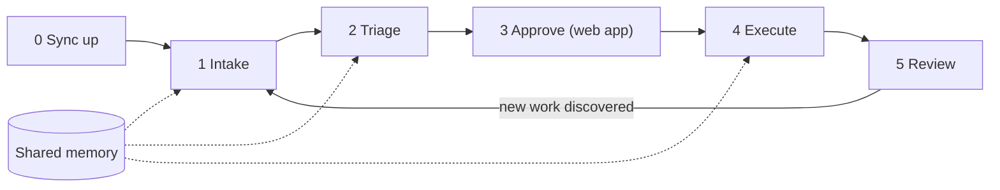
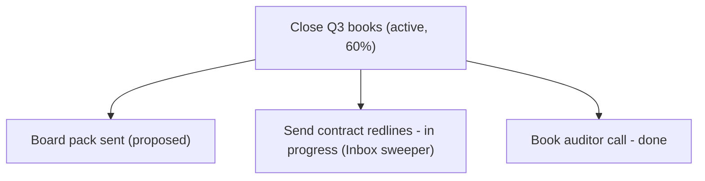
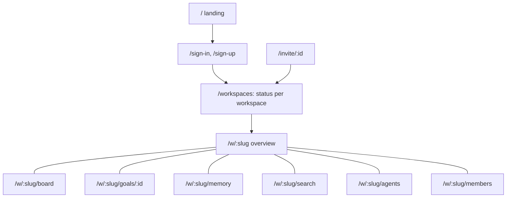

# Phean - UX Design

Phean has two surfaces, each built for one side of the work:

- **The conversation.** Agents connect over MCP, and people talk to their agents. The agent captures, triages, executes, and reports. Visual answers arrive as Mermaid diagrams in chat.
- **The web app.** People sign in to see status per workspace, approve or reject goals, step in on tasks, manage agents, and invite teammates. It refreshes itself while open, so agent work shows up without reloading.

The two meet in one shared ledger per workspace. Anything an agent does appears in the web app within seconds, and anything a person decides in the web app is what agents see next.

## Design principles

1. **Agents do the labor, people make the decisions.** Agents propose goals; only a person can approve, complete, or abandon one. This is enforced on the server, not just in the guidance, and the web app is where the decision happens.
2. **One ledger, many agents.** Several agents work in the same workspace. They coordinate through Phean (claims, duplicate detection, the activity log, shared memory) instead of through the human.
3. **Show, then tell.** Status answers lead with a picture (a diagram in chat, a stat row on the dashboard), then a short read, then one suggested next step.
4. **Zero data entry for people.** People state intent ("track that audit thread"); agents structure it. The web forms exist for corrections and quick additions, not as the main way work gets in.
5. **Every hand-off is a link.** Agents return deep links (`reviewUrl` from `create_goal`, `dashboardUrl` from `whoami` and `get_status_summary`) so a person can go straight from the chat to the decision.
6. **Read-only means read-only.** Platform admins see every workspace with a banner that says so, and the controls they cannot use are not rendered.

## The loops

### Loop 0: Sync up

**Trigger:** the start of every agent session, via the `sync_up` prompt.

**Flow:** `whoami` (identity, workspace, permissions, dashboard link), then `get_activity` to see what other agents and people did, then `list_tasks` with `claimed="mine"` to decide whether to continue or release held work, then `get_status_summary` for pending approvals and overdue tasks.

> **Agent:** Since yesterday: Calendar planner captured 4 tasks and finished "Book auditor call"; you approved **Close Q3 books**. I still hold "Send contract redlines" and will finish it now. 1 goal is waiting for your approval: [Board pack sent](https://phean.example/w/acme/goals/...).

### Loop 1: Intake

**Trigger:** "sweep my email and Slack", or the `scan_sources` prompt.

**Flow:** the agent sweeps its own connectors (Phean has none), searches Phean before capturing, then records everything in one `capture_tasks` call with `source` and a stable `sourceRef`. Phean skips anything any agent in the workspace already captured from the same source and reference, and reports those as duplicates. New tasks land in the **inbox**.

> **Human:** Morning sweep, please.
> **Agent:** Scanned 14 email threads and 3 Slack channels. Captured 6 tasks, 2 urgent (contract redlines due Thursday, incident follow-up). 1 was already captured by Calendar planner, so I skipped it. Want to triage?

### Loop 2: Triage

**Trigger:** the inbox is non-empty, or the `triage_inbox` prompt.

**Flow:** the agent groups inbox tasks under existing goals, drafts new goals where nothing fits, and asks for approval of the whole proposal in one question. On "yes" it files tasks with `assign_tasks_to_goal` (which also moves them to **to do**), sets priority and due dates with `update_task`, and calls `create_goal` for new goals. Those goals start as **proposed**, and the agent shares their review links.

> **Agent:** 6 inbox items: 3 fit **Close Q3 books**, 2 need a new goal **Website relaunch**, 1 looks like a newsletter. OK to file them and propose the relaunch goal?
> **Human:** Yes, and make the relaunch high priority.
> **Agent:** Filed 5 tasks and dropped the newsletter. **Website relaunch** is proposed; approve it here: [review](https://phean.example/w/acme/goals/...).

### Loop 3: Approve (web app)

**Trigger:** a proposed goal. The dashboard shows an amber "N goals awaiting your approval" card at the top, and the workspaces table highlights the count in amber.

**Flow:** a person clicks **Approve** or **Reject** in the card, or opens the goal for context first (its tasks, memories, and the agent that proposed it). Approved goals join the goal tree with their progress; rejected ones become **abandoned**. Agents that try to approve a goal get a clear refusal that tells them to ask a person.

Goal decisions available in the web app:

| From | Decisions |
| --- | --- |
| Proposed | Approve, Reject |
| Active | Mark achieved, Abandon (asks for confirmation) |
| Achieved | Reopen |
| Abandoned | Reactivate |

### Loop 4: Execute

**Trigger:** "what should I do next?", "handle what you can", or the `daily_review` prompt.

**Flow:** `suggest_next_actions` ranks open tasks by priority, then due date, then age, and skips tasks other agents hold. The agent calls `claim_task` before starting (which moves the task to **in progress**), does the work with its own tools, and calls `complete_task` with a one or two sentence note. If another agent got there first, the claim fails with that agent's name and the agent picks something else. Work it cannot finish goes back with `release_task`.

> **Human:** Handle what you can.
> **Agent:** Took 3: drafted the redlines reply (in your drafts), booked the auditor call for Tuesday 10:00, filed the incident report. "Prepare board pack" is claimed by Calendar planner, so I left it. 2 need you: sign the contract and approve the relaunch budget.

### Loop 5: Review

**Trigger:** "where do we stand?", or the dashboard.

**In chat:** `get_status_summary` plus `visualize` with one of three views:

- **Goal tree**: how everything ladders up, with progress rolled up from sub-goals.
- **Kanban**: tasks by status (done shows the most recent).
- **Timeline**: a Gantt chart of due dates.

**In the web app:** the same information as the dashboard and board, described below.

### Planning a goal

"Plan out the relaunch" calls `plan_goal`, which returns the goal's sub-goals, tasks, and memories plus a scaffold: definition of done, milestones, dependencies, first actions, and open questions. The agent works through it with the person, then records the result as sub-goals (`create_goal` with a parent) and tasks (`capture_tasks` straight into **to do**). The tasks are the plan; nothing is stored elsewhere.

### Memory

Agents call `remember` for durable facts, preferences, and decisions ("the CFO signs anything over $10k", "prefers Tuesday meetings"), optionally linked to a goal or task, and `recall` before asking a person something another agent may already know. People see and curate the same memory in the web app.

## Multi-agent etiquette

These rules are in the server instructions every agent receives at connection time, and the server enforces the ones marked *enforced*.

| Rule | How |
| --- | --- |
| Know who you are | `whoami` at the start of each session |
| Catch up before acting | `sync_up`, or `get_activity` with the previous `latestAt` as `since` |
| Do not duplicate | `search` before capturing; identical `source` and `sourceRef` are skipped (*enforced*) |
| Claim before working | `claim_task`; agents cannot change a task another agent holds (*enforced*) |
| Let go cleanly | `release_task` returns the task to **to do** |
| People decide goals | goal approval, completion, and abandonment are human-only (*enforced*) |
| Share what you learn | `remember` and `recall` |
| Do not bulk-drop | drop only items a person confirmed by name |

People can always step in: on the board, anyone with write access can release an agent's claim, move a task, or drop it.

## Web app

### Information architecture

Each workspace has a tab bar: **Overview, Board, Memory, Search, Agents, Members**. The header has a workspace switcher and the account menu. A workspace slug the viewer cannot see returns the same 404 as one that does not exist, so slugs do not leak.

### Screens

**Workspaces** (`/workspaces`): the status-per-customer view. One row per workspace with open, inbox, overdue, due this week, done in the last 7 days, awaiting approval, agents active in the last 24 hours out of those connected, and last activity. Overdue counts are red and pending approvals amber; zeros are faded so the rows that need attention stand out. Totals sit above the table, and a form below it creates a new workspace (the creator becomes its owner). Platform admins see every workspace, marked **Read-only**.

**Overview** (`/w/:slug`): the workspace dashboard.

- A stat row: open tasks, inbox (amber above 10), overdue (red), due this week, done in the last 7 days, active agents.
- The approval card, shown only when goals are proposed.
- The goal tree with rolled-up progress, and a **New goal** popover.
- Next actions (the same ranking agents get) and an overdue card when anything is late.
- Right column: the activity feed (people and agents, newest first) and the connected agents.
- A **Connect an agent** button when no agent is connected yet.

**Board** (`/w/:slug/board`): a kanban with Inbox, To do, In progress, Done (the 20 most recent), and Dropped. It can be filtered to one goal and its sub-goals. A one-line add-task form sits above it. Each card shows priority, due date, goal, source, and the agent holding it, plus one next-step button (Accept, Start, Done, Reopen, Restore), Release when it is claimed, and Drop while it is open.

**Goal detail** (`/w/:slug/goals/:id`): a breadcrumb of ancestor goals, the status badge and decision buttons, progress, the goal's tasks with an add-task form locked to the goal, sub-goals, linked memories with a remember form, and the goal's activity. Edit and move controls let a person retitle the goal or move it under another one; the parent picker excludes the goal's own subtree, goals already at maximum depth, and abandoned goals.

**Memory** (`/w/:slug/memory`): everything agents and people have remembered, filtered by kind (fact, preference, decision, context, note) or text. Each entry shows its kind, tags, linked goal, author, and age. A form adds a memory, and Forget asks for confirmation.

**Search** (`/w/:slug/search`): full-text search across goals, tasks, and memory, grouped by type and ranked by relevance. Prefix matching means "audit" finds "auditor".

**Agents** (`/w/:slug/agents`): owners and admins name an agent and issue its token. The token is shown **once**, with a copy button and setup tabs for Cursor, Claude Code, and VS Code that already contain the workspace's MCP URL and the token. The list shows each agent as Active (seen in the last 24 hours), Idle, or Revoked, with its token prefix, when it was last seen, and when it was connected. Revoking asks for confirmation and cuts the agent off on its next request; its past work stays attributed to it.

**Members** (`/w/:slug/members`): members with their roles, an invite form (email and role) that produces a link to send, and pending invitations. Admins manage members and agent tokens; members can do everything else, including approving goals.

**Invitation** (`/invite/:id`): signed-out visitors are sent to sign in or sign up and come back. Accepting requires being signed in with the invited email; a different account sees "Wrong account" with a sign-out option, and an expired or used link says so.

### Live refresh

Workspace pages and the workspaces table re-render every 15 seconds while the tab is visible, and every change made in the web app refreshes all of that workspace's pages immediately. There is no reload button to remember.

### Status color language

One table per concept (`src/lib/domain.ts`) maps each value to a label and a tone, and every badge, stat, and table cell reads from it, so a status looks the same everywhere.

| Tone | Color | Used for |
| --- | --- | --- |
| Danger | red | overdue, urgent priority, revoked agents |
| Warning | amber | proposed goals and pending approvals, high priority, a full inbox, read-only access |
| Info | sky | in-progress tasks, active goals, agent claims, admin role, facts |
| Success | emerald | done tasks, achieved goals, active agents, decisions |
| Accent | violet | inbox, owner role, preferences |
| Neutral | zinc | everything else |

### Forms and feedback

Every mutation is a server action with the same behavior: fields are validated with the same schema the MCP tools use, errors show inline under the form, and successful actions refresh the page or show their result in place (such as the token reveal or the invite link). Destructive actions (abandon goal, forget memory, revoke agent, remove member) ask for confirmation.

## Voice and tone (agent guidance)

- Lead with outcomes and counts ("Captured 6, 2 urgent, 1 duplicate skipped"), never tool mechanics.
- Name the other agents when their work matters ("claimed by Calendar planner").
- Batch questions for the person into one message, and include the review link when a decision is needed.
- Never say a goal is approved until a person has approved it.
- Mention inbox rot unprompted: more than 10 items, or anything older than a week.
