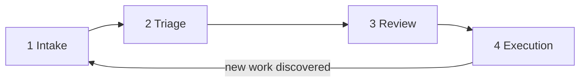
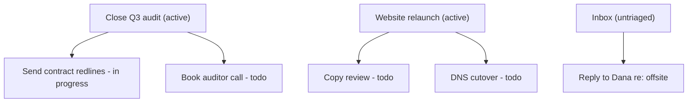
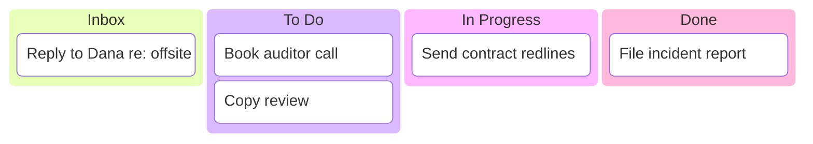
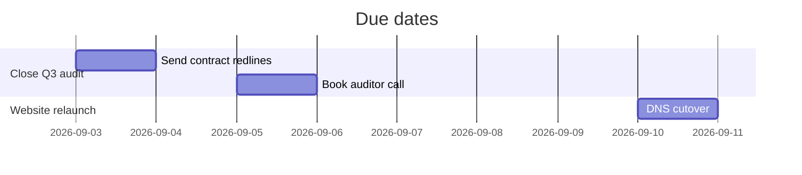

# Phean - UX Design

Phean has no screens. The UX is **conversational and agent-mediated**: the human talks to their agent, the agent operates Phean's MCP tools, and visual output arrives as Mermaid diagrams rendered inline in the chat. This document defines the four core loops, the conversation patterns for each, and the visual language of the views.

## Design principles

1. **The agent is the interface.** Every Phean interaction must work as a natural chat exchange. Tool names and IDs stay backstage; the human sees titles, summaries, and diagrams.
2. **Human authority, agent labor.** The agent never activates a goal or mass-drops tasks without an explicit human "yes" in conversation.
3. **Always show, then tell.** Status questions are answered with a diagram first, followed by a short prose summary and a suggested next step.
4. **Zero data entry for the human.** The human should never dictate task fields. They speak intent ("that email thread about the audit - track it"), the agent structures it.

## The four loops

### Loop 1: Intake

**Trigger:** human asks for a sweep ("check my email and Slack for anything actionable"), or the agent runs the `scan_sources` prompt proactively at session start.

**Flow:** the agent sweeps its own connectors, extracts actionable items, and calls `capture_tasks` once with the whole batch. Every item records its `source` and a `source_ref` (message link, thread subject, event title) so the human can trace it back. Captured tasks land in **inbox** status - capture is deliberately separated from triage so sweeps stay fast and lossless.

**Conversation pattern:**

> **Human:** Morning sweep, please.
> **Agent:** Scanned email (14 threads), Slack (3 channels), calendar (this week). Captured 6 new items into the inbox - 2 look urgent (contract redlines due Thursday, prod incident follow-up). Want to triage now?

### Loop 2: Triage

**Trigger:** inbox is non-empty; human agrees to triage, or invokes the `triage_inbox` prompt.

**Flow:** the agent lists inbox items grouped by its *proposed* goal assignment, proposes priorities and due dates, and asks for approval in one shot. On "yes", it calls `assign_tasks_to_goal` / `update_task` for the batch. New goals it invents stay `proposed` until the human approves them (then `update_goal` sets them active). Noise gets `dropped` - but only named items the human confirmed.

**Conversation pattern:**

> **Agent:** 6 inbox items. Proposal: 3 under **Close Q3 audit** (existing), 2 under a new goal **Website relaunch** (needs your approval), 1 looks like noise (newsletter). Approve all, or adjust?
> **Human:** Approve, but the relaunch is P1.
> **Agent:** Done - Website relaunch is now an active P1 goal with 2 tasks; newsletter dropped.

### Loop 3: Review

**Trigger:** "where do I stand?", "show me the board", "what's this week look like?", or the `daily_review` prompt.

**Flow:** the agent picks the right view via `visualize` and `get_status_summary`, renders the diagram, then gives a 2-3 sentence read of it with one suggested action.

**The three views:**

**Goal tree** - "how does everything ladder up?"

**Kanban** - "what's moving?"

**Timeline** - "what's due when?"

### Loop 4: Execution

**Trigger:** "what should I do next?", or the human delegates ("handle what you can").

**Flow:** `suggest_next_actions` returns open tasks ranked by priority, then due date, then age. For each, the agent either executes it directly with its own capabilities (draft the reply, book the meeting) and calls `complete_task` with a note, or flags it as human-only. Work discovered during execution feeds back into Loop 1.

**Conversation pattern:**

> **Human:** Handle what you can.
> **Agent:** Took 3: drafted the redlines reply (in your drafts folder - marked in progress until you send), booked the auditor call for Tue 10:00, filed the incident report. 2 remain that need you: sign the contract, approve relaunch budget.

## Detailed planning UX

For a big goal, "plan out the relaunch" invokes `plan_goal`, which returns the goal, its current tasks, and a breakdown scaffold (milestones, dependencies, first actions, open questions). The agent fills the scaffold conversationally with the human, then captures the agreed subtasks via `capture_tasks` directly into `todo` under that goal. The plan is not stored as a document - the tasks *are* the plan.

## Voice and tone (agent guidance)

- Lead with counts and outcomes, not tool mechanics ("Captured 6, 2 urgent" - never "I called capture_tasks").
- One question per turn during triage; batch approvals rather than item-by-item interrogation.
- Surface inbox rot: if the inbox exceeds ~10 items or holds anything older than a week, say so unprompted.
