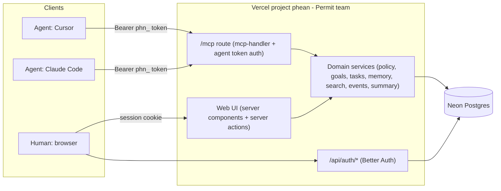
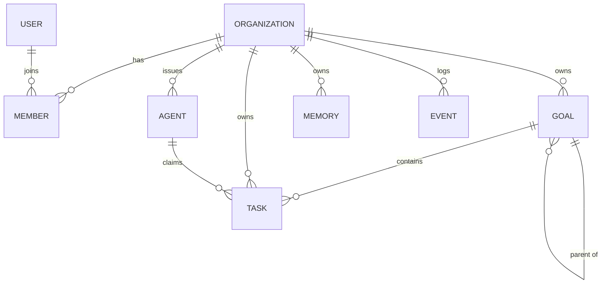

# Plan: Hosted, multi-tenant Phean on Vercel

Status: approved for execution
Owner: Or Weis
Target: a new Vercel project `phean` under the **Permit** team, backed by Neon Postgres

## 1. Goal

Turn Phean from a local, single-user stdio MCP server into a hosted, multi-tenant service:

- **Hosted on Vercel**, including storage. One deployable, no servers to run.
- **Multi-tenant with login.** Humans sign in and belong to one or more *workspaces* (tenants). Each workspace's data is isolated.
- **Many agents per workspace.** Each workspace issues agent tokens. Any number of agents (Cursor, Claude Code, background agents, ...) connect to the same workspace over remote MCP and share goals, tasks, memory, and progress.
- **Web interface** to view status per customer (workspace): goal hierarchy and progress, task board, pending approvals, agent activity, and long-term memory.
- Engineering bar: development best practices, DRY, well-designed interfaces.

## 2. Key decisions

### 2.1 Rewrite as one TypeScript Next.js app (replaces the Python server)

The MVP was a Python FastMCP stdio server. The hosted product needs an MCP endpoint, a web UI, and authentication, all on the same data. Keeping Python for MCP and adding a TypeScript UI would mean two implementations of the data layer, validation, and authorization. That is the opposite of DRY.

Decision: a single **Next.js 16 (App Router) + TypeScript** app. The MCP endpoint and the web UI are two thin adapters over **one domain service layer**. The Python package is removed (it stays in git history).

| Concern | Choice | Why |
| --- | --- | --- |
| Framework | Next.js 16 App Router | Vercel-native; server components + server actions for the UI; route handlers for MCP and auth |
| MCP transport | `mcp-handler` 2.x + `@modelcontextprotocol/server` 2.x | Vercel's adapter; stateless Streamable HTTP (2026-07-28 spec + 2025 fallback); no Redis needed |
| Validation | zod 4 | One schema per input, shared by MCP tools and server actions |
| ORM | Drizzle | Typed SQL, generated SQL migrations, works with both `pg` and PGlite |
| Auth | Better Auth + organization plugin | Self-hosted in our own Postgres; organizations = tenants, with roles and invitations |
| UI | Tailwind CSS 4 + a small in-repo component kit | No heavy UI dependency; consistent primitives |
| Tests | Vitest + PGlite | Real Postgres semantics (FTS, recursive CTEs, enums) in-process, no Docker |

### 2.2 Storage: Neon Postgres (via Vercel Marketplace)

Requirements: long-term memory, hierarchy (goals, sub-goals, tasks), strict tenant isolation, search, durable activity history, serverless-friendly.

| Option | Verdict |
| --- | --- |
| **Neon Postgres** (Vercel Marketplace; the successor of Vercel Postgres) | **Chosen.** Relational integrity for tenant scoping; recursive CTEs for hierarchy; built-in full-text search (`tsvector` + GIN); JSONB for event payloads; `pgvector` available for semantic memory later; branch-per-preview-deployment; pooled connections for serverless |
| Upstash Redis / KV | No relational queries or hierarchy; poor fit as system of record |
| Vercel Blob / Edge Config | Files and config only |
| Supabase | Capable, but brings its own auth stack that overlaps with ours |
| Turso (libSQL) | Viable, but weaker search and hierarchy ergonomics than Postgres |

Connection: `pg` (node-postgres) pool against Neon's pooled connection string, registered with `attachDatabasePool` from `@vercel/functions` so Fluid compute closes idle clients correctly. Local development and tests use **PGlite** (Postgres in WebAssembly) through the same Drizzle schema, selected by `DATABASE_URL`.

### 2.3 Identity and tenancy

- **Humans** authenticate with Better Auth: email and password out of the box; GitHub and Google OAuth when their credentials are configured.
- **Tenants** are Better Auth *organizations* (UI name: "workspace"). Roles: `owner`, `admin`, `member`. Invitations are created in the UI and shared as links (no email provider required for MVP).
- **Agents** authenticate to MCP with a **workspace agent token** (`phn_...`), created by an owner/admin in the web UI and shown once. Only a SHA-256 hash is stored. Each token is a named agent identity, so every change is attributed ("Cursor on Or's laptop completed X").
- **Platform admins** (emails in `PHEAN_PLATFORM_ADMINS`) get a read-only view of every workspace's status. This is the Permit-operator view of status per customer.

MCP OAuth (needed for Claude.ai/ChatGPT connectors) is phase 2: Better Auth can act as the authorization server, and `mcp-handler` already serves protected-resource metadata.

### 2.4 Authorization: one policy function

All permission checks go through `can(actor, action)` in `src/server/domain/policy.ts`, backed by a single role-to-action matrix. Services call `assertCan` before any read or write. This is the extension point to swap in Permit.io for fine-grained policy later, without touching callers.

The **human-approval principle is enforced server-side**, not just in prompt guidance:

- Goals created by agents are always `proposed`. Goals created by humans start `active`.
- Only humans can change a goal's status (approve, achieve, abandon). Agents get a link to the approval page instead.

## 3. Architecture



Request flow: an adapter (MCP tool or server action) resolves a **context** `{ db, tenant, actor }` from the bearer token or session, validates input with the shared zod schema, and calls a domain service. Services enforce policy, scope every query by `tenant_id`, write the change and an activity event in one transaction, and return plain data. Adapters only format the result.

### 3.1 Code layout

```
src/
├── app/                              # Next.js routes (adapters only)
│   ├── page.tsx                      # Landing
│   ├── (auth)/sign-in, sign-up       # Login screens
│   ├── workspaces/                   # Status per customer (all my workspaces)
│   ├── w/[slug]/                     # One workspace: dashboard, board, goals/[id], memory, search, agents, members
│   ├── invite/[id]/                  # Accept invitation
│   ├── mcp/route.ts                  # Remote MCP endpoint
│   └── api/auth/[...all], api/health
├── components/
│   ├── ui/                           # Design-system primitives (Button, Card, Badge, Input, ...)
│   └── *.tsx                         # Domain components (GoalTree, TaskCard, ActivityFeed, ...)
├── lib/                              # Client-safe: domain constants, labels, formatting
├── server/
│   ├── db/                           # Drizzle schema (auth + domain), client factory, ids
│   ├── auth/                         # Better Auth config, session and tenant resolution
│   ├── domain/                       # Services, policy, zod schemas, errors, context
│   └── mcp/                          # Declarative tools, prompts, instructions, handler factory
└── proxy.ts                          # Optimistic auth redirect (Next 16 "proxy", formerly middleware)
drizzle/                              # Generated SQL migrations (committed)
scripts/migrate.ts                    # Applies migrations to Postgres or PGlite
tests/                                # Vitest suites
```

### 3.2 Interfaces (the contracts everything else depends on)

```ts
type Actor =
  | { type: "user"; id: string; name: string; role: "owner" | "admin" | "member" | "platform_admin" }
  | { type: "agent"; id: string; name: string; role: "agent" };

interface Ctx {
  db: Db;                                     // Drizzle database (Postgres or PGlite)
  tenant: { id: string; slug: string; name: string };
  actor: Actor;
}

// Every domain service has this shape; input types are inferred from shared zod schemas.
type Service<I, O> = (ctx: Ctx, input: I) => Promise<O>;

// MCP tools are declared, not hand-wired:
defineTool({ name, title, description, input: ZodObject, readOnly?, run: (ctx, input) => Promise<O> });

// Server actions are wrapped once:
tenantAction(schema, (ctx, input) => Promise<O>);   // resolves session -> Ctx, parses FormData, revalidates
```

## 4. Data model



Auth tables (`user`, `session`, `account`, `verification`, `organization`, `member`, `invitation`) are generated from the Better Auth config. Domain tables:

| Table | Key columns | Notes |
| --- | --- | --- |
| `agents` | `id`, `tenant_id`, `name`, `token_hash` (unique), `token_prefix`, `created_by`, `last_seen_at`, `revoked_at` | `last_seen_at` updated at most once per minute |
| `goals` | `id`, `tenant_id`, `parent_id` (self FK), `title`, `description`, `status` enum, `approved_by`, `approved_at`, `created_by_*`, `search` tsvector | Hierarchy as an adjacency list; depth limit 4; cycle check via recursive CTE |
| `tasks` | `id`, `tenant_id`, `goal_id`, `title`, `description`, `status` enum, `priority` enum, `source` enum, `source_ref`, `due_date`, `tags` text[], `claimed_by_agent_id`, `claimed_at`, `completed_at`, `created_by_*`, `search` tsvector | Unique `(tenant_id, source, source_ref)` when `source_ref` is set, so agents scanning the same inbox do not duplicate tasks |
| `memories` | `id`, `tenant_id`, `kind` enum (`fact`, `preference`, `decision`, `context`, `note`), `content`, `tags`, `goal_id`, `task_id`, `created_by_*`, `search` tsvector | Long-term memory shared by all agents in the workspace |
| `events` | `id`, `tenant_id`, `actor_type`, `actor_id`, `actor_name`, `action`, `entity_type`, `entity_id`, `summary`, `data` jsonb, `created_at` | Append-only activity log; index on `(tenant_id, created_at desc)` |

Every domain table carries `tenant_id` with a foreign key to `organization` (`on delete cascade`) and leading indexes on `tenant_id`. Search vectors are generated columns (`title` weight A, `description` weight B) with GIN indexes. Queries use prefix matching (`term:*`), so "audit" finds "auditor".

Enums are defined once as `as const` arrays in `src/lib/domain.ts` and reused by the Postgres enums, the zod schemas, and the UI labels.

## 5. MCP surface (remote, per workspace)

Endpoint: `https://<deployment>/mcp`, header `Authorization: Bearer phn_...`. The token identifies both the workspace and the agent, so no tool takes a tenant argument.

| Area | Tools |
| --- | --- |
| Identity | `whoami` (agent, workspace, dashboard URL) |
| Goals | `create_goal` (always proposed for agents), `update_goal` (title, description, parent), `list_goals` (tree with roll-up progress), `get_goal` (goal + sub-goals + tasks + memories + recent activity) |
| Tasks | `capture_tasks` (bulk; dedupes on source + source_ref), `list_tasks`, `update_task`, `assign_tasks_to_goal`, `claim_task`, `release_task`, `complete_task` |
| Memory | `remember`, `recall`, `forget` |
| Search | `search` (tasks, goals, memories) |
| Planning | `plan_goal` (scaffold), `suggest_next_actions` (skips tasks claimed by other agents) |
| Views | `visualize` (`goal_tree`, `kanban`, `timeline` as Mermaid), `get_status_summary` |
| Coordination | `get_activity` (what other agents and humans did, optionally since a timestamp) |

Prompts: `scan_sources`, `triage_inbox`, `daily_review`, `sync_up` (catch up on activity and claims at session start). Server instructions explain the loop, multi-agent etiquette (claim before working, check activity first, never duplicate), and the approval rule.

Tool results are returned as JSON text plus `structuredContent`. Domain errors (validation, not found, forbidden, conflict) become `isError` results with an actionable message.

## 6. Web interface

| Route | Purpose |
| --- | --- |
| `/` | Landing: what Phean is; sign in / get started |
| `/sign-in`, `/sign-up` | Email and password, plus GitHub/Google buttons when configured |
| `/workspaces` | **Status per customer**: one card per workspace (open tasks, inbox, overdue, pending approvals, active agents, last activity). Platform admins see all workspaces. Create a workspace |
| `/w/[slug]` | Workspace dashboard: stat cards, pending approvals (approve/reject inline), goal tree with roll-up progress, next actions, overdue, live activity feed, agents |
| `/w/[slug]/board` | Kanban by status with goal filter, move actions, quick capture |
| `/w/[slug]/goals/[id]` | Goal detail: status actions, sub-goals, tasks, linked memories, activity |
| `/w/[slug]/memory` | Long-term memory, filterable by kind, searchable |
| `/w/[slug]/search` | Unified search across goals, tasks, memories |
| `/w/[slug]/agents` | Create and revoke agent tokens; copy-paste MCP config for Cursor and Claude Code; last seen |
| `/w/[slug]/members` | Members and roles; create invitation links |
| `/invite/[id]` | Accept an invitation |

Workspace pages auto-refresh every 15 seconds, so humans watch agents work in near real time without websockets.

## 7. Delivery steps

1. **Plan** (this document).
2. **Scaffold**: Next.js 16, TypeScript strict, Tailwind 4, ESLint, Vitest, pnpm; remove the Python package.
3. **Database**: Drizzle schema for auth and domain tables, client factory (Postgres or PGlite), generated migrations, `scripts/migrate.ts`.
4. **Domain layer**: context, errors, policy, zod schemas, and services. All tenant scoping and event logging live here.
5. **MCP layer**: declarative tool registry, prompts, instructions, handler factory with agent-token verification, `/mcp` route.
6. **Auth**: Better Auth config, `/api/auth` route, session and tenant resolution helpers, `proxy.ts`, invitations.
7. **Web UI**: component kit, then pages in the order of the table above.
8. **Tests**: domain services, policy matrix, tenant isolation, agent tokens, and MCP over HTTP (an MCP client calling the real handler in-process); typecheck, lint, production build.
9. **End-to-end check**: run locally on PGlite, sign up, create a workspace, issue two agent tokens, drive both agents over HTTP MCP, and verify the dashboard.
10. **Docs**: README, PRD, UX, ARCHITECTURE, DEPLOYMENT.
11. **Deploy** to Vercel under the Permit team (see section 9).

## 8. Testing strategy

- **Unit and integration (Vitest)**: each suite gets a fresh in-memory PGlite database with migrations applied, so tests exercise real SQL (enums, generated columns, FTS, recursive CTEs, unique indexes).
- **Isolation**: explicit tests that an agent or user in workspace A cannot read or modify anything in workspace B, through both services and MCP.
- **Policy**: matrix tests for every role and action, including agents being unable to approve goals.
- **MCP contract**: an MCP SDK client connects through `StreamableHTTPClientTransport` with a `fetch` shim that calls the route handler directly. This covers auth (401 without a token, revoked tokens), the tool list, and real tool calls.
- **Static checks**: `tsc --noEmit`, ESLint, `next build`.

## 9. Deployment (Vercel, Permit team)

1. Create the project: `vercel link --scope permit --project phean` (or import `orweis/phean` in the Vercel dashboard under the Permit team).
2. Add storage: Vercel dashboard, Storage, Neon Postgres (or `vercel integration add neon`). This injects `DATABASE_URL` into all environments; enable Neon preview branching.
3. Set environment variables: `BETTER_AUTH_SECRET` (`openssl rand -base64 32`); optional `GITHUB_CLIENT_ID`/`GITHUB_CLIENT_SECRET`, `GOOGLE_CLIENT_ID`/`GOOGLE_CLIENT_SECRET`, `PHEAN_PLATFORM_ADMINS`.
4. Deploy: the `vercel-build` script runs migrations and then `next build`. Pin the function region next to the Neon region.
5. Smoke test: sign up, create a workspace, create an agent token, connect an MCP client to `/mcp`.

## 10. Risks and mitigations

| Risk | Mitigation |
| --- | --- |
| Cross-tenant data leak | Tenant id comes only from the verified session or token, never from tool input; every query is scoped in the service layer; isolation tests. Postgres row-level security is a phase-2 defense in depth |
| Leaked agent token | Hashed at rest, shown once, revocable instantly, `last_seen_at` visible in UI |
| Agents racing on the same task | `claim_task` is an atomic conditional update; conflicts return an error naming the current claimer |
| Duplicate capture from multiple agents | Unique index on `(tenant_id, source, source_ref)`; capture reports duplicates instead of failing |
| Serverless connection exhaustion | Neon pooled endpoint + `attachDatabasePool` |
| MCP clients without header support | Document `mcp-remote` bridge; MCP OAuth in phase 2 |

## 11. Out of scope (phase 2+)

- MCP OAuth (authorization server) for connectors that cannot send headers.
- Semantic memory with `pgvector` embeddings.
- Postgres row-level security, rate limiting on `/mcp`.
- Email delivery for invitations; notifications and digests.
- Permit.io-backed fine-grained authorization behind `can()`.
- Billing and plans.
